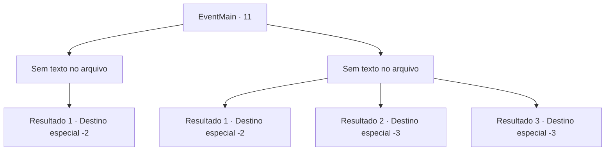

# Eventos principais · 11

[Índice da tabela](index.md) · [Índice geral](../index.md)

ID: `pt:EventMain:11` · Fonte: `EventMain4` · Versão: 1.2.47.

Mapeamento estático dos arquivos; a disponibilidade e a execução dependem do estado da run.

## Texto do evento

*Sem texto no arquivo.*

## Dados de entrada

```json
{
  "id": 11,
  "grade": 1,
  "normalGoal": "0",
  "required": ""
}
```

## Mapa das escolhas



## Escolhas e resultados

### Escolha 1

*Sem texto no arquivo; o papel dessa opção depende da interface do jogo.*

Requisitos e outros campos da escolha:

```json
{
  "required": ""
}
```

#### Resultado 1.1

Você domina os elfos facilmente.  Eles perdem coragem e começam a correr.  Os pioneiros comemoram gritando seu nome.  Você comemora com eles.

Continuação registrada: [Destino especial `-2`](../destinos-especiais.md).

```json
{
  "required": "",
  "chance": "1",
  "nextEvent": -2,
  "type": 2,
  "reward": "0_2_3|13_0_8"
}
```

### Escolha 2

*Sem texto no arquivo; o papel dessa opção depende da interface do jogo.*

Requisitos e outros campos da escolha:

```json
{
  "required": ""
}
```

#### Resultado 2.1

Você fica ferido e recua das linhas inimigas.  Em seguida, os pioneiros perdem a coragem e começam a correr.  Você corre com eles, abandonando o acampamento.

Continuação registrada: [Destino especial `-2`](../destinos-especiais.md).

```json
{
  "required": "1_0_2|1_1_2",
  "chance": "1",
  "nextEvent": -2,
  "type": 2,
  "reward": "0_2_2|13_0_10|0_0_-1|0_1_-1"
}
```

#### Resultado 2.2

Você fica gravemente ferido e perde a consciência.

Continuação registrada: [Destino especial `-3`](../destinos-especiais.md).

```json
{
  "required": "2_0_2",
  "chance": "1",
  "nextEvent": -3,
  "type": 2,
  "reward": "0_0_-1|0_1_-1"
}
```

#### Resultado 2.3

Você fica gravemente ferido e perde a consciência.

Continuação registrada: [Destino especial `-3`](../destinos-especiais.md).

```json
{
  "required": "2_1_2",
  "chance": "1",
  "nextEvent": -3,
  "type": 2,
  "reward": "0_0_-1|0_1_-1"
}
```

## Referências que chegam a este evento

- [Evento 10 · escolha 1 · resultado 1](0010.md#escolha-1)
- [Evento 10 · escolha 2 · resultado 1](0010.md#escolha-2)
