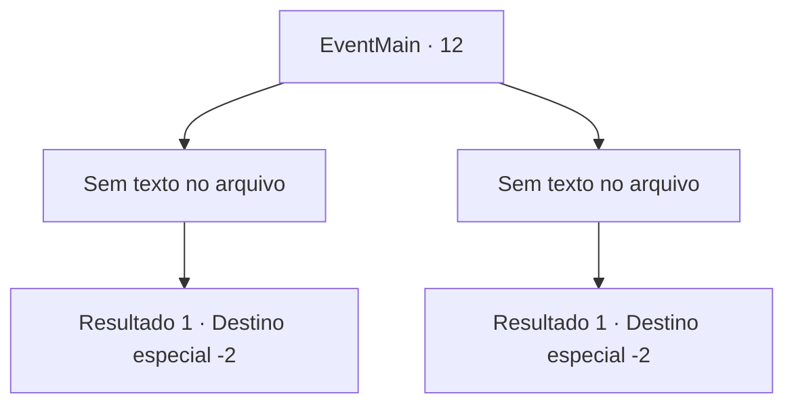

# Eventos principais · 12

[Índice da tabela](index.md) · [Índice geral](../index.md)

ID: `pt:EventMain:12` · Fonte: `EventMain4` · Versão: 1.2.47.

Mapeamento estático dos arquivos; a disponibilidade e a execução dependem do estado da run.

## Texto do evento

*Sem texto no arquivo.*

## Dados de entrada

```json
{
  "id": 12,
  "grade": 1,
  "normalGoal": "0",
  "required": ""
}
```

## Mapa das escolhas



## Escolhas e resultados

### Escolha 1

*Sem texto no arquivo; o papel dessa opção depende da interface do jogo.*

Requisitos e outros campos da escolha:

```json
{
  "required": ""
}
```

#### Resultado 1.1

Você ajuda os elfos a derrubarem os pioneiros. Irelle os avisa. 

 "Eu lhes darei tempo para correr. Desmontem o acampamento e vão embora até o final do ano."

 Os pioneiros se levantam e fogem. Observando-os, Irelle expressa sua gratidão. 

 "Aqui nos encontramos novamente. Que mundo pequeno. Obrigado pela ajuda."

 E com isso, ele desaparece na floresta com os outros elfos.

Continuação registrada: [Destino especial `-2`](../destinos-especiais.md).

```json
{
  "required": "",
  "chance": "1",
  "nextEvent": -2,
  "type": 2,
  "reward": "0_2_2|13_0_9|5_72_1"
}
```

### Escolha 2

*Sem texto no arquivo; o papel dessa opção depende da interface do jogo.*

Requisitos e outros campos da escolha:

```json
{
  "required": ""
}
```

#### Resultado 2.1

Você ajuda os elfos a derrubar os pioneiros. Irelle os avisa. 

 "Eu lhe darei tempo para correr. Desmontem o acampamento e vão embora até o final do ano."

 Os pioneiros se levantam e fogem. Observando-os, Irelle expressa sua gratidão. 

 "Aqui nos encontramos novamente. Que mundo pequeno. Você está bem?"

 E com isso, ele desaparece na floresta com os outros elfos.

Continuação registrada: [Destino especial `-2`](../destinos-especiais.md).

```json
{
  "required": "",
  "chance": "1",
  "nextEvent": -2,
  "type": 2,
  "reward": "13_0_9|0_2_2|5_72_1"
}
```

## Referências que chegam a este evento

- [Evento 4 · escolha 2 · resultado 1](0004.md#escolha-2)
