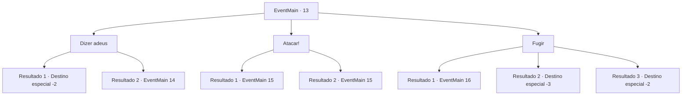

# Eventos principais · 13

[Índice da tabela](index.md) · [Índice geral](../index.md)

ID: `pt:EventMain:13` · Fonte: `EventMain4` · Versão: 1.2.47.

Mapeamento estático dos arquivos; a disponibilidade e a execução dependem do estado da run.

## Texto do evento

A fumaça sobe do distante acampamento dos colonizadores. A luta entre os elfos e os colonos começou. Você se apressa em direção ao acampamento.|drawing_basecampFire| Você atravessa uma pequena floresta e um riacho para chegar lá, mas já é tarde demais. Colonos que não conseguiram escapar estão sangrando no chão. Os elfos comemoram em celebração antes de todos virarem para olhar para você.

## Dados de entrada

```json
{
  "id": 13,
  "grade": 1,
  "normalGoal": "0",
  "required": "13_0_6|1_2_75"
}
```

## Mapa das escolhas



## Escolhas e resultados

### Escolha 1

Dizer adeus

Requisitos e outros campos da escolha:

```json
{
  "required": ""
}
```

#### Resultado 1.1

Você se despede e sai às pressas. Os elfos devem pensar que você é algum tipo de comerciante viajante. Eles não perseguem você.

Continuação registrada: [Destino especial `-2`](../destinos-especiais.md).

```json
{
  "required": "2_12_10",
  "chance": "1",
  "nextEvent": -2,
  "type": 2,
  "reward": "13_0_7|0_2_2"
}
```

#### Resultado 1.2

Você diz adeus e tenta ir embora. Mas um dos elfos lhe reconhece. 

 "Você é um deles. Não, você pode não estar a caminho."

 Ele pega um punhal e joga em você. A lâmina com ponta de veneno voa pelo ar em sua direção.

Continuação registrada: [Evento 14](0014.md) na mesma tabela.

```json
{
  "required": "1_12_10",
  "chance": "1",
  "nextEvent": 14,
  "type": 2,
  "reward": ""
}
```

### Escolha 2

Atacar!

Requisitos e outros campos da escolha:

```json
{
  "required": ""
}
```

#### Resultado 2.1

Gritando agressivamente, você ataca os elfos. Os elfos riem de sua imprudência. Você está em uma luta muito difícil.

Continuação registrada: [Evento 15](0015.md) na mesma tabela.

```json
{
  "required": "",
  "chance": "10",
  "nextEvent": 15,
  "type": 1,
  "reward": "6_3_72",
  "place": 1
}
```

#### Resultado 2.2

 Gritando agressivamente, você ataca os elfos. Você derruba um deles com um único golpe. Os outros são pegos de surpresa enquanto sacam suas armas às pressas. Os pioneiros olham para você com esperança nos olhos.

Continuação registrada: [Evento 15](0015.md) na mesma tabela.

```json
{
  "required": "",
  "chance": "1|0_5_1",
  "nextEvent": 15,
  "type": 0,
  "reward": "6_2_72|0_2_1",
  "place": 1
}
```

### Escolha 3

Fugir

Requisitos e outros campos da escolha:

```json
{
  "required": ""
}
```

#### Resultado 3.1

Você corre a toda velocidade. Mas você leva uma flecha élfica no joelho. Os elfos se aglomeram ao seu redor enquanto você cai. Eles não lhe deixam outra escolha.

Continuação registrada: [Evento 16](0016.md) na mesma tabela.

```json
{
  "required": "1_0_2",
  "chance": "13",
  "nextEvent": 16,
  "type": 1,
  "reward": "6_0_72|0_0_-1",
  "place": 1
}
```

#### Resultado 3.2

Você corre a toda velocidade, mas um elfo lhe mata com uma flechada.

Continuação registrada: [Destino especial `-3`](../destinos-especiais.md).

```json
{
  "required": "2_0_2",
  "chance": "13",
  "nextEvent": -3,
  "type": 1,
  "reward": "0_0_-1"
}
```

#### Resultado 3.3

Você corre a toda velocidade. Flechas e adagas passam zunindo, mas nenhuma lhe acerta. Você foge deles sem se ferir.

Continuação registrada: [Destino especial `-2`](../destinos-especiais.md).

```json
{
  "required": "",
  "chance": "1|0_6_1",
  "nextEvent": -2,
  "type": 0,
  "reward": "13_0_7|0_2_1"
}
```

## Referências que chegam a este evento

Nenhum `nextEvent` positivo da mesma tabela aponta para este nó. Isso não prova que seja inacessível: sorteio e estado de história podem selecioná-lo.

