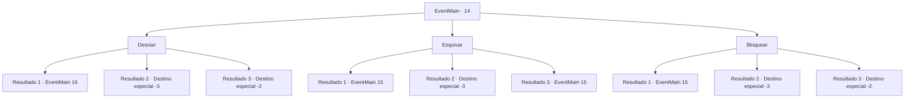

# Eventos principais · 14

[Índice da tabela](index.md) · [Índice geral](../index.md)

ID: `pt:EventMain:14` · Fonte: `EventMain4` · Versão: 1.2.47.

Mapeamento estático dos arquivos; a disponibilidade e a execução dependem do estado da run.

## Texto do evento

*Sem texto no arquivo.*

## Dados de entrada

```json
{
  "id": 14,
  "grade": 1,
  "normalGoal": "0",
  "required": ""
}
```

## Mapa das escolhas



## Escolhas e resultados

### Escolha 1

Desviar

Requisitos e outros campos da escolha:

```json
{
  "required": ""
}
```

#### Resultado 1.1

Você falha em desviar da adaga. Os elfos vêm gritando. 

 "O humano foi atingido! Não tem para onde fugir agora!"

 Eles não lhe deixam outra escolha.

Continuação registrada: [Evento 16](0016.md) na mesma tabela.

```json
{
  "required": "1_0_2",
  "chance": "13",
  "nextEvent": 16,
  "type": 1,
  "reward": "6_0_72|0_0_-1",
  "place": 1
}
```

#### Resultado 1.2

Você é morto por uma adaga indo em sua direção.

Continuação registrada: [Destino especial `-3`](../destinos-especiais.md).

```json
{
  "required": "2_0_2",
  "chance": "13",
  "nextEvent": -3,
  "type": 1,
  "reward": "0_0_-1"
}
```

#### Resultado 1.3

Você consegue desviar dos projéteis e fugir sem se machucar.

Continuação registrada: [Destino especial `-2`](../destinos-especiais.md).

```json
{
  "required": "",
  "chance": "1|0_6_1",
  "nextEvent": -2,
  "type": 0,
  "reward": "13_0_7|0_2_1"
}
```

### Escolha 2

Esquivar

Requisitos e outros campos da escolha:

```json
{
  "required": ""
}
```

#### Resultado 2.1

Você falha em aparar a adaga. Os elfos vêm aos berros. 

 "O humano foi atingido! Não tem para onde fugir agora!"

 Eles não lhe deixam outra escolha.

Continuação registrada: [Evento 15](0015.md) na mesma tabela.

```json
{
  "required": "1_0_2",
  "chance": "11",
  "nextEvent": 15,
  "type": 1,
  "reward": "6_0_72|0_0_-1",
  "place": 1
}
```

#### Resultado 2.2

Você é morto por uma adaga indo em sua direção.

Continuação registrada: [Destino especial `-3`](../destinos-especiais.md).

```json
{
  "required": "2_0_2",
  "chance": "11",
  "nextEvent": -3,
  "type": 1,
  "reward": "0_0_-1"
}
```

#### Resultado 2.3

Você apara a adaga o mais forte que pode. A adaga ricocheteia de volta ao seu dono na garganta dele. Os elfos lhe cercam, mas hesitam em atacar você. Os pioneiros olham para você com esperança em seus olhos. Você decide realizar essa esperança enquanto lentamente saca sua arma.

Continuação registrada: [Evento 15](0015.md) na mesma tabela.

```json
{
  "required": "",
  "chance": "1|0_5_1",
  "nextEvent": 15,
  "type": 0,
  "reward": "6_2_72|0_2_1",
  "place": 1
}
```

### Escolha 3

Bloquear

Requisitos e outros campos da escolha:

```json
{
  "required": "20_9_1"
}
```

#### Resultado 3.1

Você falha em aparar a adaga. Os elfos vêm aos berros. 

 "O humano foi atingido! Não tem pra onde correr agora!"

 Eles lhe deixam sem outra escolha.

Continuação registrada: [Evento 15](0015.md) na mesma tabela.

```json
{
  "required": "1_0_2",
  "chance": "1",
  "nextEvent": 15,
  "type": 1,
  "reward": "6_0_72|0_0_-1",
  "place": 1
}
```

#### Resultado 3.2

Você é morto por uma adaga indo em sua direção.

Continuação registrada: [Destino especial `-3`](../destinos-especiais.md).

```json
{
  "required": "2_0_2",
  "chance": "1",
  "nextEvent": -3,
  "type": 1,
  "reward": "0_0_-1"
}
```

#### Resultado 3.3

Você consegue bloquear os projéteis e fugir sem se machucar.

Continuação registrada: [Destino especial `-2`](../destinos-especiais.md).

```json
{
  "required": "",
  "chance": "1",
  "nextEvent": -2,
  "type": 0,
  "reward": "13_0_7|0_2_1"
}
```

## Referências que chegam a este evento

- [Evento 13 · escolha 1 · resultado 2](0013.md#escolha-1)
