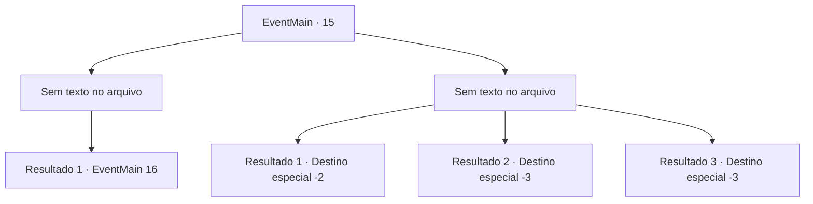

# Eventos principais · 15

[Índice da tabela](index.md) · [Índice geral](../index.md)

ID: `pt:EventMain:15` · Fonte: `EventMain4` · Versão: 1.2.47.

Mapeamento estático dos arquivos; a disponibilidade e a execução dependem do estado da run.

## Texto do evento

*Sem texto no arquivo.*

## Dados de entrada

```json
{
  "id": 15,
  "grade": 1,
  "normalGoal": "0",
  "required": ""
}
```

## Mapa das escolhas



## Escolhas e resultados

### Escolha 1

*Sem texto no arquivo; o papel dessa opção depende da interface do jogo.*

Requisitos e outros campos da escolha:

```json
{
  "required": ""
}
```

#### Resultado 1.1

Muitos elfos caem aos seus pés. Mas ainda há muitos de pé, e eles continuam vindo.

Continuação registrada: [Evento 16](0016.md) na mesma tabela.

```json
{
  "required": "",
  "chance": "1",
  "nextEvent": 16,
  "type": 2,
  "reward": "6_0_72",
  "place": 1
}
```

### Escolha 2

*Sem texto no arquivo; o papel dessa opção depende da interface do jogo.*

Requisitos e outros campos da escolha:

```json
{
  "required": ""
}
```

#### Resultado 2.1

Você está ferido, e precisa escapar.

Continuação registrada: [Destino especial `-2`](../destinos-especiais.md).

```json
{
  "required": "1_0_2|1_1_2",
  "chance": "1",
  "nextEvent": -2,
  "type": 2,
  "reward": "13_0_10|0_0_-1|0_1_-1|0_2_2"
}
```

#### Resultado 2.2

Você chega ao seu fim cercado por elfos.

Continuação registrada: [Destino especial `-3`](../destinos-especiais.md).

```json
{
  "required": "2_0_2",
  "chance": "1",
  "nextEvent": -3,
  "type": 2,
  "reward": "0_0_-1|0_1_-1"
}
```

#### Resultado 2.3

Você chega ao seu fim cercado por elfos.

Continuação registrada: [Destino especial `-3`](../destinos-especiais.md).

```json
{
  "required": "2_1_2",
  "chance": "1",
  "nextEvent": -3,
  "type": 2,
  "reward": "0_0_-1|0_1_-1"
}
```

## Referências que chegam a este evento

- [Evento 13 · escolha 2 · resultado 1](0013.md#escolha-2)
- [Evento 13 · escolha 2 · resultado 2](0013.md#escolha-2)
- [Evento 14 · escolha 2 · resultado 1](0014.md#escolha-2)
- [Evento 14 · escolha 2 · resultado 3](0014.md#escolha-2)
- [Evento 14 · escolha 3 · resultado 1](0014.md#escolha-3)
