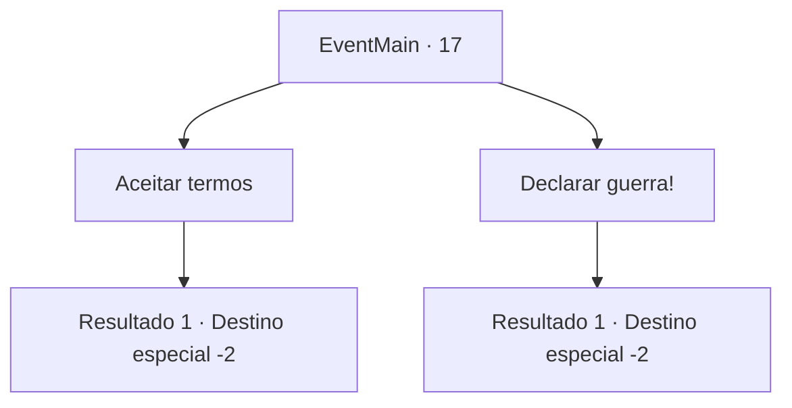

# Eventos principais · 17

[Índice da tabela](index.md) · [Índice geral](../index.md)

ID: `pt:EventMain:17` · Fonte: `EventMain4` · Versão: 1.2.47.

Mapeamento estático dos arquivos; a disponibilidade e a execução dependem do estado da run.

## Texto do evento

Você parou no acampamento dos colonizadores para saciar sua fome. Naquele momento, alguns elfos chegaram ao acampamento dos colonizadores.|drawing_elves| Eles convocaram você e outros colonos para apresentar uma proposta de negociação. 

 "Esta é a nossa proposta. Reconhecemos as terras que vocês colonizaram até agora como seu território, e não vamos invadir. No entanto, não expandam mais suas colônias."

 E acrescentaram que esta seria a última concessão.

## Dados de entrada

```json
{
  "id": 17,
  "grade": 1,
  "normalGoal": "0",
  "required": "1_2_70|13_0_4"
}
```

## Mapa das escolhas



## Escolhas e resultados

### Escolha 1

Aceitar termos

Requisitos e outros campos da escolha:

```json
{
  "required": ""
}
```

#### Resultado 1.1

Você diz a eles que aceita seus termos. Os pioneiros concordam, relembrando sua batalha recente. Os elfos saem, prometendo voltar para o acordo oficial.

Continuação registrada: [Destino especial `-2`](../destinos-especiais.md).

```json
{
  "required": "",
  "chance": "1",
  "nextEvent": -2,
  "type": 2,
  "reward": "13_0_11|0_2_2"
}
```

### Escolha 2

Declarar guerra!

Requisitos e outros campos da escolha:

```json
{
  "required": ""
}
```

#### Resultado 2.1

Você recusa a oferta de misericórdia deles. Os pioneiros parecem assustados, talvez pelas suas memórias da batalha recente. Mas eles, ainda assim, concordam com você. 

 "Vocês humanos são simplesmente incompreensíveis."

 Os elfos não escondem seu desgosto. Eles saem, mas é óbvio que eles voltarão.

Continuação registrada: [Destino especial `-2`](../destinos-especiais.md).

```json
{
  "required": "",
  "chance": "1",
  "nextEvent": -2,
  "type": 2,
  "reward": "13_0_12|0_2_2"
}
```

## Referências que chegam a este evento

Nenhum `nextEvent` positivo da mesma tabela aponta para este nó. Isso não prova que seja inacessível: sorteio e estado de história podem selecioná-lo.

