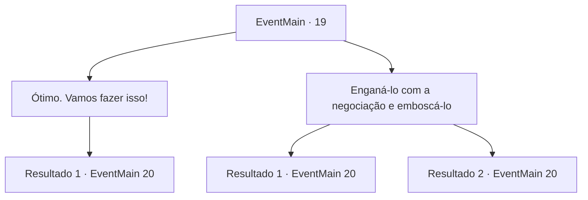

# Eventos principais · 19

[Índice da tabela](index.md) · [Índice geral](../index.md)

ID: `pt:EventMain:19` · Fonte: `EventMain4` · Versão: 1.2.47.

Mapeamento estático dos arquivos; a disponibilidade e a execução dependem do estado da run.

## Texto do evento

Você estava massageando seus pés inchados no acampamento dos colonos.|drawing_alram| Nesse momento, o som de um sino de alerta ecoou da torre de vigia do acampamento. Isso significava que os elfos estavam vindo atacar. Os colonos se prepararam rapidamente para o combate. A legião dos elfos avançou diretamente em direção ao acampamento. E Irelle estava na frente, correndo diretamente em direção a você. 

 "Parece que isso era o destino. Já nos poupamos uma vez, agora vamos resolver isso de uma vez."


## Dados de entrada

```json
{
  "id": 19,
  "grade": 1,
  "normalGoal": "0",
  "required": "13_0_12|1_2_80"
}
```

## Mapa das escolhas



## Escolhas e resultados

### Escolha 1

Ótimo. Vamos fazer isso!

Requisitos e outros campos da escolha:

```json
{
  "required": ""
}
```

#### Resultado 1.1

Irelle dá um sorriso gélido. Você trava lâminas com Irelle enquanto a batalha entre as duas espécies se inicia.

Continuação registrada: [Evento 20](0020.md) na mesma tabela.

```json
{
  "required": "",
  "chance": "1",
  "nextEvent": 20,
  "type": 2,
  "reward": "6_0_60",
  "place": 1
}
```

### Escolha 2

Enganá-lo com a negociação e emboscá-lo

Requisitos e outros campos da escolha:

```json
{
  "required": ""
}
```

#### Resultado 2.1

Você diz a Irelle que ainda há tempo para negociação. Mas ele balança a cabeça. 

 "Muito pequeno, muito tarde, humano."

 Os pioneiros olham para você como se você fosse insano. A batalha entre as duas espécies se inicia, e você trava lâminas com Irelle.

Continuação registrada: [Evento 20](0020.md) na mesma tabela.

```json
{
  "required": "",
  "chance": "10",
  "nextEvent": 20,
  "type": 1,
  "reward": "6_3_60",
  "place": 1
}
```

#### Resultado 2.2

Você diz a Irelle que ainda há tempo para negociação. Você estende sua mão, como se querendo um gracioso aperto de mão. Ele perplexamente estende o braço e você aproveita a chance e o acerta. 

 "Seu... covarde imundo!"

 Ele solta um breve grito enquanto sangue escorre do ferimento. Ele então range os dentes e corre na sua direção. Com isso, a batalha entre as duas espécies se inicia.

Continuação registrada: [Evento 20](0020.md) na mesma tabela.

```json
{
  "required": "",
  "chance": "1|0_12_1",
  "nextEvent": 20,
  "type": 0,
  "reward": "0_3_-1|6_2_60",
  "place": 1
}
```

## Referências que chegam a este evento

Nenhum `nextEvent` positivo da mesma tabela aponta para este nó. Isso não prova que seja inacessível: sorteio e estado de história podem selecioná-lo.

