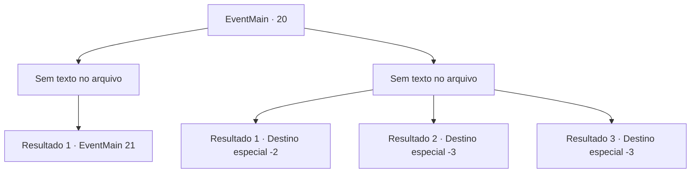

# Eventos principais · 20

[Índice da tabela](index.md) · [Índice geral](../index.md)

ID: `pt:EventMain:20` · Fonte: `EventMain4` · Versão: 1.2.47.

Mapeamento estático dos arquivos; a disponibilidade e a execução dependem do estado da run.

## Texto do evento

*Sem texto no arquivo.*

## Dados de entrada

```json
{
  "id": 20,
  "grade": 1,
  "normalGoal": "0",
  "required": ""
}
```

## Mapa das escolhas



## Escolhas e resultados

### Escolha 1

*Sem texto no arquivo; o papel dessa opção depende da interface do jogo.*

Requisitos e outros campos da escolha:

```json
{
  "required": ""
}
```

#### Resultado 1.1

Irelle cai lentamente. Os elfos perdem a coragem e fogem enquanto ele cai. Os pioneiros celebram cantando seu nome. Irelle está inconsciente no chão.

Continuação registrada: [Evento 21](0021.md) na mesma tabela.

```json
{
  "required": "",
  "chance": "1",
  "nextEvent": 21,
  "type": 2,
  "reward": ""
}
```

### Escolha 2

*Sem texto no arquivo; o papel dessa opção depende da interface do jogo.*

Requisitos e outros campos da escolha:

```json
{
  "required": ""
}
```

#### Resultado 2.1

Quando você chega perto dos portões da morte, um pioneiro vai ao seu resgate. Você estava longe da linha de frente para receber os primeiros-socorros. Enquanto isso, os elfos empurraram de volta os pioneiros. Ao pôr do sol, os pioneiros estavam fugindo dos elfos. Você corre com eles, deixando a fronteira para trás.

Continuação registrada: [Destino especial `-2`](../destinos-especiais.md).

```json
{
  "required": "1_0_2|1_1_2",
  "chance": "1",
  "nextEvent": -2,
  "type": 2,
  "reward": "0_0_-1|0_1_-1|0_2_2|13_0_10"
}
```

#### Resultado 2.2

A última coisa que você vê é a lâmina afiada dele voando em direção à sua garganta.

Continuação registrada: [Destino especial `-3`](../destinos-especiais.md).

```json
{
  "required": "2_0_2",
  "chance": "1",
  "nextEvent": -3,
  "type": 2,
  "reward": "0_0_-1|0_1_-1"
}
```

#### Resultado 2.3

A última coisa que você vê é a lâmina afiada dele voando em direção à sua garganta.

Continuação registrada: [Destino especial `-3`](../destinos-especiais.md).

```json
{
  "required": "2_1_2",
  "chance": "1",
  "nextEvent": -3,
  "type": 2,
  "reward": "0_0_-1|0_1_-1"
}
```

## Referências que chegam a este evento

- [Evento 18 · escolha 1 · resultado 1](0018.md#escolha-1)
- [Evento 18 · escolha 2 · resultado 1](0018.md#escolha-2)
- [Evento 18 · escolha 2 · resultado 2](0018.md#escolha-2)
- [Evento 19 · escolha 1 · resultado 1](0019.md#escolha-1)
- [Evento 19 · escolha 2 · resultado 1](0019.md#escolha-2)
- [Evento 19 · escolha 2 · resultado 2](0019.md#escolha-2)
