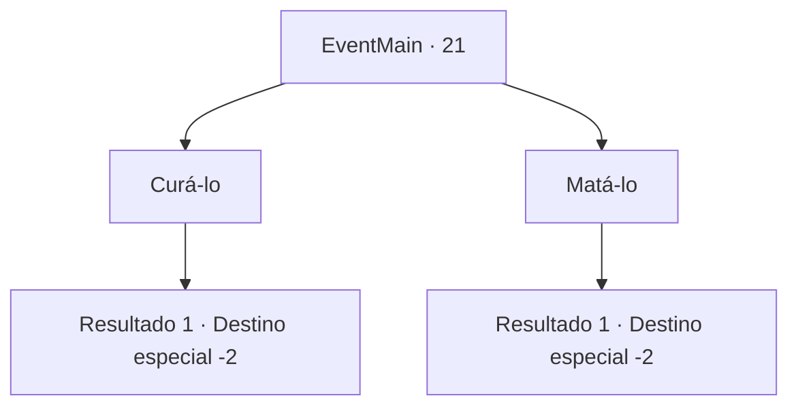

# Eventos principais · 21

[Índice da tabela](index.md) · [Índice geral](../index.md)

ID: `pt:EventMain:21` · Fonte: `EventMain4` · Versão: 1.2.47.

Mapeamento estático dos arquivos; a disponibilidade e a execução dependem do estado da run.

## Texto do evento

*Sem texto no arquivo.*

## Dados de entrada

```json
{
  "id": 21,
  "grade": 1,
  "normalGoal": "",
  "required": ""
}
```

## Mapa das escolhas



## Escolhas e resultados

### Escolha 1

Curá-lo

Requisitos e outros campos da escolha:

```json
{
  "required": ""
}
```

#### Resultado 1.1

Você pede a alguns pioneiros que cuidem dos ferimentos dele. Alguns deles parecem relutantes, mas nenhum fala sobre isso. 

 Alguns dias mais tarde, Irelle vai até você depois de recobrar a consciência. Ele lhe agradece e lhe dá ouro. Quando você o pega, ele sai. Você põe o dinheiro no seu bolso e continua sua jornada.

Continuação registrada: [Destino especial `-2`](../destinos-especiais.md).

```json
{
  "required": "",
  "chance": "1",
  "nextEvent": -2,
  "type": 2,
  "reward": "13_0_11|0_2_3|0_3_5|0_4_200"
}
```

### Escolha 2

Matá-lo

Requisitos e outros campos da escolha:

```json
{
  "required": ""
}
```

#### Resultado 2.1

Você o mata. O sangue dele pinta o chão de vermelho, combinando com o pôr do sol no céu. Pioneiros festejam. Você bebe com os pioneiros em celebração à sua vitória. Você continua sua jornada no dia seguinte com uma terrível ressaca.

Continuação registrada: [Destino especial `-2`](../destinos-especiais.md).

```json
{
  "required": "",
  "chance": "1",
  "nextEvent": -2,
  "type": 2,
  "reward": "0_2_4|13_0_8"
}
```

## Referências que chegam a este evento

- [Evento 20 · escolha 1 · resultado 1](0020.md#escolha-1)
