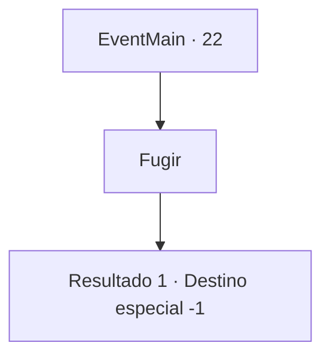

# Eventos principais · 22

[Índice da tabela](index.md) · [Índice geral](../index.md)

ID: `pt:EventMain:22` · Fonte: `EventMain4` · Versão: 1.2.47.

Mapeamento estático dos arquivos; a disponibilidade e a execução dependem do estado da run.

## Texto do evento

|drawing_arrest| Você testemunhou alguém sendo preso pelos guardas da ordem. Ao olhar mais de perto, percebeu que ele era um dos colonos. Você teve a sensação instintiva de que não deveria ser pego pelos guardas. Por algum motivo, parece que a guarda está prendendo os colonos.

## Dados de entrada

```json
{
  "id": 22,
  "grade": 1,
  "normalGoal": "0",
  "required": "13_0_7|1_2_100"
}
```

## Mapa das escolhas



## Escolhas e resultados

### Escolha 1

Fugir

Requisitos e outros campos da escolha:

```json
{
  "required": ""
}
```

#### Resultado 1.1

Você não tem escolha a não ser correr. Muitos outros pioneiros fazem o mesmo e desaparecem. Você falha em se tornar o grande aventureiro dos seus sonhos, e nota que o sol se pôs na sua jornada.

Continuação registrada: [Destino especial `-1`](../destinos-especiais.md).

```json
{
  "required": "",
  "chance": "1",
  "nextEvent": -1,
  "type": 2,
  "reward": "15_1_1"
}
```

## Referências que chegam a este evento

Nenhum `nextEvent` positivo da mesma tabela aponta para este nó. Isso não prova que seja inacessível: sorteio e estado de história podem selecioná-lo.

