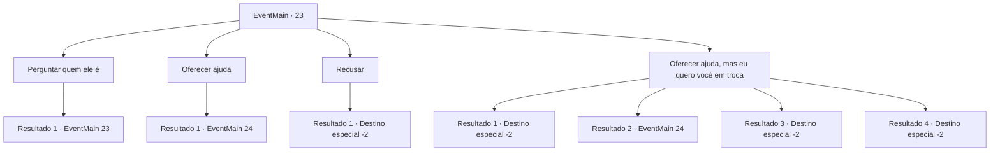

# Eventos principais · 23

[Índice da tabela](index.md) · [Índice geral](../index.md)

ID: `pt:EventMain:23` · Fonte: `EventMain4` · Versão: 1.2.47.

Mapeamento estático dos arquivos; a disponibilidade e a execução dependem do estado da run.

## Texto do evento

Um elfo se aproximou de você. Era Irelle, que você havia encontrado na última vez. 

 "Eu procurei por você. Vamos direto ao ponto. Ajude-nos."

 Ele olhou nos seus olhos e disse: 

 "Vamos te aceitar em nossa tribo élfica e protegê-lo. Você nos ajudou da última vez, atrapalhando os colonos. Por isso, eles estão procurando uma oportunidade para se vingar de você. Não seria melhor para você também expulsá-los?"


## Dados de entrada

```json
{
  "id": 23,
  "grade": 1,
  "normalGoal": "0",
  "required": "13_0_9|1_2_75|5_72_2"
}
```

## Mapa das escolhas



## Escolhas e resultados

### Escolha 1

Perguntar quem ele é

Requisitos e outros campos da escolha:

```json
{
  "required": "5_8_0"
}
```

#### Resultado 1.1

Você pergunta a ele sua identidade. Ele dá uma resposta honesta. 

 "Nós somos nativos da terra que os humanos chamam de fronteira. Minha irmã é a nossa Rainha e eu sou o cavaleiro dela."


Continuação registrada: [Evento 23](0023.md) na mesma tabela.

```json
{
  "required": "",
  "chance": "1",
  "nextEvent": 23,
  "type": 2,
  "reward": "5_8_1"
}
```

### Escolha 2

Oferecer ajuda

Requisitos e outros campos da escolha:

```json
{
  "required": ""
}
```

#### Resultado 2.1

Por que não?' , você pensa. Você o segue até a casa dele entre árvores gigantes. 

 "Nós vamos destruir os campos humanos e bani-los dessa terra. Seu trabalho é distraí-los para que possamos preparar a emboscada. Como você vai fazer isso, é com você."

 Ele lhe alcança um pergaminho sinalizador, para que você possa avisar ele depois da distração. |drawing_nightCamp| Você sai da casa de Irelle e vai diretamente ao campo dos pioneiros. Você cruza as florestas e rios, chegando lá ao pôr do sol. Está escuro, mas há um guarda com uma tocha na torre de vigia.

Continuação registrada: [Evento 24](0024.md) na mesma tabela.

```json
{
  "required": "",
  "chance": "1",
  "nextEvent": 24,
  "type": 2,
  "reward": "3_54_1"
}
```

### Escolha 3

Recusar

Requisitos e outros campos da escolha:

```json
{
  "required": ""
}
```

#### Resultado 3.1

Você diz não ao elfo. Ele sai sem lhe incomodar mais.

Continuação registrada: [Destino especial `-2`](../destinos-especiais.md).

```json
{
  "required": "",
  "chance": "1",
  "nextEvent": -2,
  "type": 2,
  "reward": "13_0_13"
}
```

### Escolha 4

Oferecer ajuda, mas eu quero você em troca

Requisitos e outros campos da escolha:

```json
{
  "required": "8_46_1|24_1_1"
}
```

#### Resultado 4.1

Você entrega a Irelle um anel de prata, dizendo que você quer a mão dele em troca da sua ajuda aos elfos. Irelle suspira e cruza os braços. 

 "Uff... Que forma estranha de dizer não. Não vou irei lhe incomodar."

 Ele rapidamente corre para a floresta, não entendendo sua intenção ou simplesmente desgostando de você.

Continuação registrada: [Destino especial `-2`](../destinos-especiais.md).

```json
{
  "required": "1_3_0",
  "chance": "14",
  "nextEvent": -2,
  "type": 1,
  "reward": "13_0_13"
}
```

#### Resultado 4.2

Você entrega a Irelle um anel de prata, dizendo que você quer a mão dele em troca da sua ajuda aos elfos. Ele encara seus olhos, acena com a cabeça e fala. 

 "Se você tem certeza de que eu sou aquele que você deseja. Contudo, você pode se arrepender disso."

 Depois de responder sem emoção, Irelle coloca o anel de prata no dedo. Então, ele lhe entrega o pingente dele. 

 "Este é o símbolo da nossa promessa. Assim como o anel que você me deu."

 Você o segue pela floresta de árvores gigantes, chegando à casa dele. 

 "Nós vamos destruir os campos humanos e tirá-los dessa terra. Seu trabalho é distraí-los para que possamos preparar a emboscada. Como você vai fazer isso, é com você."

 Ele lhe alcança um pergaminho sinalizador, para que você possa avisar ele depois que seu trabalho estiver feito. |drawing_nightCamp| Você sai da casa de Irelle, e vai diretamente ao campo dos pioneiros.
 Você cruza as florestas e rios, chegando lá ao pôr do sol. Está completamente escuro, mas há patrulhas com tochas na torre de vigia e em torno das barricadas de madeira
.

Continuação registrada: [Evento 24](0024.md) na mesma tabela.

```json
{
  "required": "1_3_0",
  "chance": "1|0_12_1",
  "nextEvent": 24,
  "type": 0,
  "reward": "3_54_1|3_152_1|5_8_2|4_46_1"
}
```

#### Resultado 4.3

Você entrega a Irelle um anel de prata, dizendo que você quer a mão dele em troca da sua ajuda aos elfos. Irelle responde com um olhar severo. 

 "Você é muito... cheio de karma para ser meu companheiro."

 Ele rapidamente corre para a floresta, aparentemente desgostando de você.

Continuação registrada: [Destino especial `-2`](../destinos-especiais.md).

```json
{
  "required": "2_3_0",
  "chance": "1",
  "nextEvent": -2,
  "type": 2,
  "reward": "13_0_13"
}
```

#### Resultado 4.4

Você entrega a Irelle um anel de prata, dizendo que você quer a mão dele em troca da sua ajuda aos elfos. Irelle responde com um olhar severo. 

 "Você é muito... cheio de karma para ser meu companheiro."

 Ele rapidamente corre para a floresta, aparentemente desgostando de você.

Continuação registrada: [Destino especial `-2`](../destinos-especiais.md).

```json
{
  "required": "5_182_3",
  "chance": "1",
  "nextEvent": -2,
  "type": 2,
  "reward": "13_0_13"
}
```

## Referências que chegam a este evento

- [Evento 23 · escolha 1 · resultado 1](0023.md#escolha-1)
