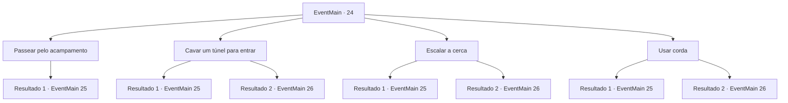

# Eventos principais · 24

[Índice da tabela](index.md) · [Índice geral](../index.md)

ID: `pt:EventMain:24` · Fonte: `EventMain4` · Versão: 1.2.47.

Mapeamento estático dos arquivos; a disponibilidade e a execução dependem do estado da run.

## Texto do evento

*Sem texto no arquivo.*

## Dados de entrada

```json
{
  "id": 24,
  "grade": 1,
  "normalGoal": "0",
  "required": ""
}
```

## Mapa das escolhas



## Escolhas e resultados

### Escolha 1

Passear pelo acampamento

Requisitos e outros campos da escolha:

```json
{
  "required": ""
}
```

#### Resultado 1.1

Você anda reto pelo campo deles. Os pioneiros lembram de como você ajudou os elfos. 

 "É aquele traidor fode-elfos! Você está morto!"

 Os pioneiros sacam suas armas e correm raivosamente na sua direção.

Continuação registrada: [Evento 25](0025.md) na mesma tabela.

```json
{
  "required": "",
  "chance": "1",
  "nextEvent": 25,
  "type": 2,
  "reward": "6_0_62|0_2_1",
  "place": 1
}
```

### Escolha 2

Cavar um túnel para entrar

Requisitos e outros campos da escolha:

```json
{
  "required": "8_38_1"
}
```

#### Resultado 2.1

Você tenta cavar um túnel para entrar no campo. Mas você não é um grande cavador. Quando você olha para cima de dentro de seu buraco raso na terra, você está cercado por guardas.

Continuação registrada: [Evento 25](0025.md) na mesma tabela.

```json
{
  "required": "",
  "chance": "15",
  "nextEvent": 25,
  "type": 1,
  "reward": "6_3_62|0_2_1",
  "place": 1
}
```

#### Resultado 2.2

Você se esconde entre os arbustos e cava. Você está coberto de suor quando água começa a jorrar do chão. A pressão manda você voando pelo ar, e você cai na copa de uma árvore. O gêiser chama a atenção dos pioneiros. Você inesperadamente, mas com sucesso, distrai eles. |drawing_flare| Ainda empoleirado no todo da sua árvore, você rasga o pergaminho sinalizador. Ele manda orbes brilhantes de luz ao céu. A emboscada élfica imediatamente começa.

Continuação registrada: [Evento 26](0026.md) na mesma tabela.

```json
{
  "required": "",
  "chance": "1|0_5_1",
  "nextEvent": 26,
  "type": 0,
  "reward": "6_2_62|4_54_1|0_2_1",
  "place": 1
}
```

### Escolha 3

Escalar a cerca

Requisitos e outros campos da escolha:

```json
{
  "required": ""
}
```

#### Resultado 3.1

Você começa a escalar a cerca de madeira. Assim que você está prestes a pousar do outro lado, o guarda encontra você.

Continuação registrada: [Evento 25](0025.md) na mesma tabela.

```json
{
  "required": "",
  "chance": "18",
  "nextEvent": 25,
  "type": 1,
  "reward": "6_0_62|0_2_1",
  "place": 1
}
```

#### Resultado 3.2

Você começa a escalar a cerca de madeira. Ninguém no campo nota. Você vê o depósito de equipamentos e os quartos. Você silenciosamente pega fogo da fornalha e incendeia ambos.|drawing_basecampFire|As chamas crescem, e a pessoas correm de lá para cá para apagá-las. Você rasga o pergaminho sinalizador em meio ao pânico deles. Ele manda orbes brilhantes de luz ao céu. A emboscada élfica imediatamente começa.

Continuação registrada: [Evento 26](0026.md) na mesma tabela.

```json
{
  "required": "",
  "chance": "1|0_6_1",
  "nextEvent": 26,
  "type": 0,
  "reward": "6_2_62|4_54_1",
  "place": 1
}
```

### Escolha 4

Usar corda

Requisitos e outros campos da escolha:

```json
{
  "required": "8_39_1"
}
```

#### Resultado 4.1

Você começa a escalar a cerca de madeira. Assim que você está prestes a pousar do outro lado, o guarda encontra você.

Continuação registrada: [Evento 25](0025.md) na mesma tabela.

```json
{
  "required": "",
  "chance": "6",
  "nextEvent": 25,
  "type": 1,
  "reward": "6_0_62|0_2_1",
  "place": 1
}
```

#### Resultado 4.2

Você começa a escalar a cerca de madeira usando a corda. Ninguém no campo nota. Você vê o depósito de equipamentos e os quartos. Você silenciosamente pega fogo da fornalha e incendeia ambos.|drawing_basecampFire|As chamas crescem, e a pessoas correm de lá para cá para apagá-las. Você rasga o pergaminho sinalizador em meio ao pânico deles. Ele manda orbes brilhantes de luz ao céu. A emboscada élfica imediatamente começa.

Continuação registrada: [Evento 26](0026.md) na mesma tabela.

```json
{
  "required": "",
  "chance": "1|0_6_1",
  "nextEvent": 26,
  "type": 0,
  "reward": "6_2_62|4_54_1|4_39_1|0_2_1",
  "place": 1
}
```

## Referências que chegam a este evento

- [Evento 23 · escolha 2 · resultado 1](0023.md#escolha-2)
- [Evento 23 · escolha 4 · resultado 2](0023.md#escolha-4)
