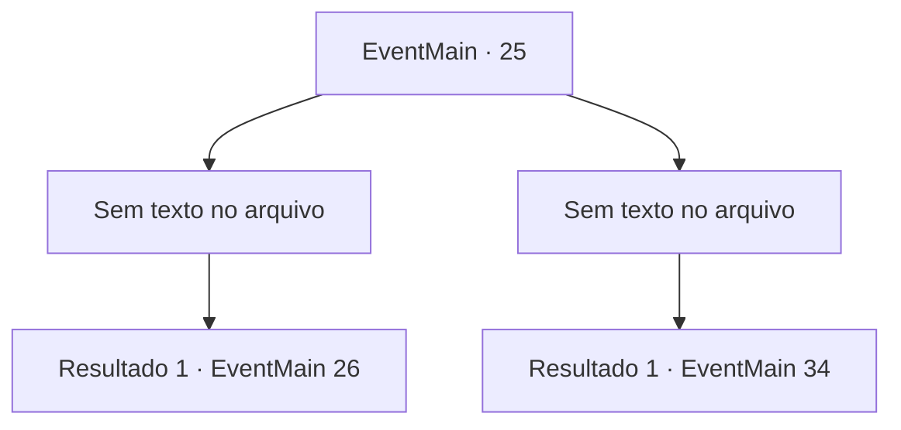

# Eventos principais · 25

[Índice da tabela](index.md) · [Índice geral](../index.md)

ID: `pt:EventMain:25` · Fonte: `EventMain4` · Versão: 1.2.47.

Mapeamento estático dos arquivos; a disponibilidade e a execução dependem do estado da run.

## Texto do evento

*Sem texto no arquivo.*

## Dados de entrada

```json
{
  "id": 25,
  "grade": 1,
  "normalGoal": "0",
  "required": ""
}
```

## Mapa das escolhas



## Escolhas e resultados

### Escolha 1

*Sem texto no arquivo; o papel dessa opção depende da interface do jogo.*

Requisitos e outros campos da escolha:

```json
{
  "required": ""
}
```

#### Resultado 1.1

Você derruba os pioneiros que chegam até você, mas acaba atraindo mais deles no processo. Você rasga o pergaminho sinalizador enquanto corre deles. Ele manda orbes brilhantes de luz ao céu. A emboscada élfica imediatamente começa.

Continuação registrada: [Evento 26](0026.md) na mesma tabela.

```json
{
  "required": "",
  "chance": "1",
  "nextEvent": 26,
  "type": 2,
  "reward": "6_0_62|4_54_1",
  "place": 1
}
```

### Escolha 2

*Sem texto no arquivo; o papel dessa opção depende da interface do jogo.*

Requisitos e outros campos da escolha:

```json
{
  "required": ""
}
```

#### Resultado 2.1

Você é cercado por guardas. Eles lhe amarram e lhe enviam de volta ao seu país. 

 Você chega alguns dias depois em má forma. Você é julgado pouco tempo depois, e sentenciado a morte por alta traição. Espalha-se a notícia de que você se aliou aos elfos em uma tentativa de motim.

Continuação registrada: [Evento 34](0034.md) na mesma tabela.

```json
{
  "required": "",
  "chance": "1",
  "nextEvent": 34,
  "type": 2,
  "reward": "13_0_17|0_2_2"
}
```

## Referências que chegam a este evento

- [Evento 24 · escolha 1 · resultado 1](0024.md#escolha-1)
- [Evento 24 · escolha 2 · resultado 1](0024.md#escolha-2)
- [Evento 24 · escolha 3 · resultado 1](0024.md#escolha-3)
- [Evento 24 · escolha 4 · resultado 1](0024.md#escolha-4)
