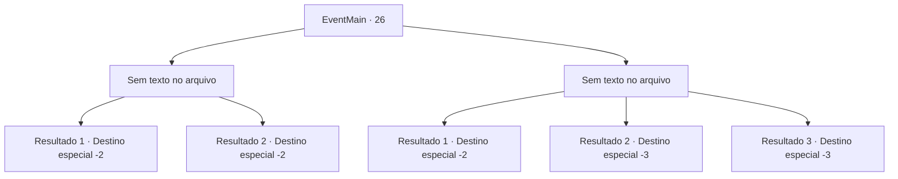

# Eventos principais · 26

[Índice da tabela](index.md) · [Índice geral](../index.md)

ID: `pt:EventMain:26` · Fonte: `EventMain4` · Versão: 1.2.47.

Mapeamento estático dos arquivos; a disponibilidade e a execução dependem do estado da run.

## Texto do evento

*Sem texto no arquivo.*

## Dados de entrada

```json
{
  "id": 26,
  "grade": 1,
  "normalGoal": "0",
  "required": ""
}
```

## Mapa das escolhas



## Escolhas e resultados

### Escolha 1

*Sem texto no arquivo; o papel dessa opção depende da interface do jogo.*

Requisitos e outros campos da escolha:

```json
{
  "required": ""
}
```

#### Resultado 1.1

Os pioneiros caem impotentes. Alguns resistem intensamente, mas a maré já virou, e a maioria morre ou foge. Os elfos soltaram seu grito de vitória. Irelle coloca a mão em seu ombro. 

 "Bom trabalho. Pegue isso"

 Irelle lhe entrega seu arco e diz que respeita seu trabalho duro. Você pega o arco e continua sua jornada.

Continuação registrada: [Destino especial `-2`](../destinos-especiais.md).

```json
{
  "required": "18_8_2",
  "chance": "1",
  "nextEvent": -2,
  "type": 2,
  "reward": "13_0_14|0_2_3|0_1_2|3_80_1"
}
```

#### Resultado 1.2

Os pioneiros caem impotentes. Alguns resistem intensamente, mas a maré já virou, e a maioria morre ou foge. Os elfos soltaram seu grito de vitória. Irelle coloca a mão em seu ombro. 

 "Bom trabalho."

 Irelle entrega a você o arco dele e põe o anel de prata no seu dedo. 

 "Um anel seria melhor que um pingente..."

 Então ele rapidamente sai. Você pega o arco e o anel de prata e continua sua jornada.

Continuação registrada: [Destino especial `-2`](../destinos-especiais.md).

```json
{
  "required": "5_8_2",
  "chance": "1",
  "nextEvent": -2,
  "type": 2,
  "reward": "13_0_14|0_2_3|0_1_2|3_80_1|3_46_1"
}
```

### Escolha 2

*Sem texto no arquivo; o papel dessa opção depende da interface do jogo.*

Requisitos e outros campos da escolha:

```json
{
  "required": ""
}
```

#### Resultado 2.1

Os elfos sofrem muitas baixas mas falham em afastar os pioneiros. Irelle decide que eles não podem mais lutar e ordena uma retirada. Você está gravemente ferido e os elfos carregam você embora.

Continuação registrada: [Destino especial `-2`](../destinos-especiais.md).

```json
{
  "required": "1_0_2|1_1_2",
  "chance": "1",
  "nextEvent": -2,
  "type": 2,
  "reward": "13_0_15|0_0_-1|0_1_-1|0_2_2"
}
```

#### Resultado 2.2

Você e os outros pioneiros morrem em batalha de ferimentos fatais.

Continuação registrada: [Destino especial `-3`](../destinos-especiais.md).

```json
{
  "required": "2_0_2",
  "chance": "1",
  "nextEvent": -3,
  "type": 2,
  "reward": "0_0_-1|0_1_-1"
}
```

#### Resultado 2.3

Você e os outros pioneiros morrem em batalha de ferimentos fatais.

Continuação registrada: [Destino especial `-3`](../destinos-especiais.md).

```json
{
  "required": "2_1_2",
  "chance": "1",
  "nextEvent": -3,
  "type": 2,
  "reward": "0_0_-1|0_1_-1"
}
```

## Referências que chegam a este evento

- [Evento 24 · escolha 2 · resultado 2](0024.md#escolha-2)
- [Evento 24 · escolha 3 · resultado 2](0024.md#escolha-3)
- [Evento 24 · escolha 4 · resultado 2](0024.md#escolha-4)
- [Evento 25 · escolha 1 · resultado 1](0025.md#escolha-1)
