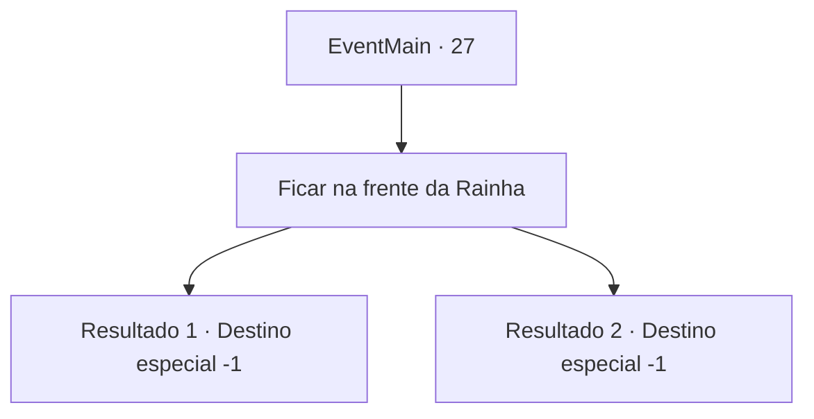

# Eventos principais · 27

[Índice da tabela](index.md) · [Índice geral](../index.md)

ID: `pt:EventMain:27` · Fonte: `EventMain4` · Versão: 1.2.47.

Mapeamento estático dos arquivos; a disponibilidade e a execução dependem do estado da run.

## Texto do evento

Você monta acampamento ao pôr do sol. Irelle vem vê-lo. 

 "A Rainha convoca você. Ela quer recompensá-lo por sua ajuda."

 Irelle leva você para a vila élfica. 

 Você atravessa a floresta labiríntica e fica na frente da colossal árvore branca no centro da vila. A luz do sol brilha através de suas folhas, realçando sua natureza sagrada. A Rainha Élfica espera ao pé da árvore com muitos elfos.

## Dados de entrada

```json
{
  "id": 27,
  "grade": 1,
  "normalGoal": "0",
  "required": "13_0_14|1_2_100"
}
```

## Mapa das escolhas



## Escolhas e resultados

### Escolha 1

Ficar na frente da Rainha

Requisitos e outros campos da escolha:

```json
{
  "required": ""
}
```

#### Resultado 1.1

|drawing_elvenPrize|Ela lhe coroa com uma coroa de galhos brancos. 

 "Obrigada por proteger nossas terras. Em honra aos seus esforços, eu lhe nomeio protetor de nossa tribo."

 Elfos celebram e parabenizam você. Você se tornou um grande aventureiro de formas que você não esperava.

Continuação registrada: [Destino especial `-1`](../destinos-especiais.md).

```json
{
  "required": "18_8_2",
  "chance": "1",
  "nextEvent": -1,
  "type": 2,
  "reward": "15_1_4"
}
```

#### Resultado 1.2

|drawing_elvenPrize|Ela fala com você, pondo em sua cabeça uma coroa feita de galhos brancos. 

 "Obrigada por proteger nossas terras. Eu pessoalmente aprecio o que fizeste por nós elfos, e também parabenizo seu casamento com meu irmão."

 Após sua declaração, os elfos reunidos gritam empolgados, parabenizando você. Você se tornou um grande aventureiro, embora um pouco diferente de o que você sonhava.

Continuação registrada: [Destino especial `-1`](../destinos-especiais.md).

```json
{
  "required": "5_8_2",
  "chance": "1",
  "nextEvent": -1,
  "type": 2,
  "reward": "15_1_4|15_1_13"
}
```

## Referências que chegam a este evento

Nenhum `nextEvent` positivo da mesma tabela aponta para este nó. Isso não prova que seja inacessível: sorteio e estado de história podem selecioná-lo.

