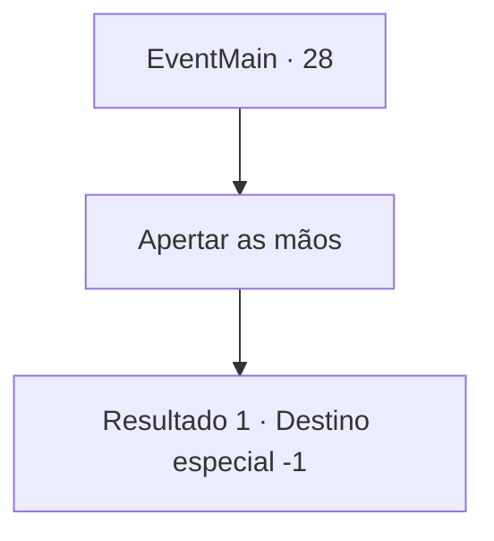

# Eventos principais · 28

[Índice da tabela](index.md) · [Índice geral](../index.md)

ID: `pt:EventMain:28` · Fonte: `EventMain4` · Versão: 1.2.47.

Mapeamento estático dos arquivos; a disponibilidade e a execução dependem do estado da run.

## Texto do evento

Chegada a hora de você assinar o acordo com os elfos. Os representantes élficos já estão lá quando você chega. Você negocia com sucesso com eles como representante ao lado de outros pioneiros. Os elfos certificam o territórios dos pioneiros, e os pioneiros juram nunca mais invadir as terras élficas novamente. |drawing_contract|

## Dados de entrada

```json
{
  "id": 28,
  "grade": 1,
  "normalGoal": "0",
  "required": "13_0_11|1_2_100"
}
```

## Mapa das escolhas



## Escolhas e resultados

### Escolha 1

Apertar as mãos

Requisitos e outros campos da escolha:

```json
{
  "required": ""
}
```

#### Resultado 1.1

Você aperta a mãos dos representantes élficos. O acordo cessa a luta entre elfos e humanos, para que eles possam viver pacificamente pelos próximos anos. Por quanto tempo, porém, ninguém pode dizer...

Continuação registrada: [Destino especial `-1`](../destinos-especiais.md).

```json
{
  "required": "",
  "chance": "1",
  "nextEvent": -1,
  "type": 2,
  "reward": "15_1_2"
}
```

## Referências que chegam a este evento

Nenhum `nextEvent` positivo da mesma tabela aponta para este nó. Isso não prova que seja inacessível: sorteio e estado de história podem selecioná-lo.

