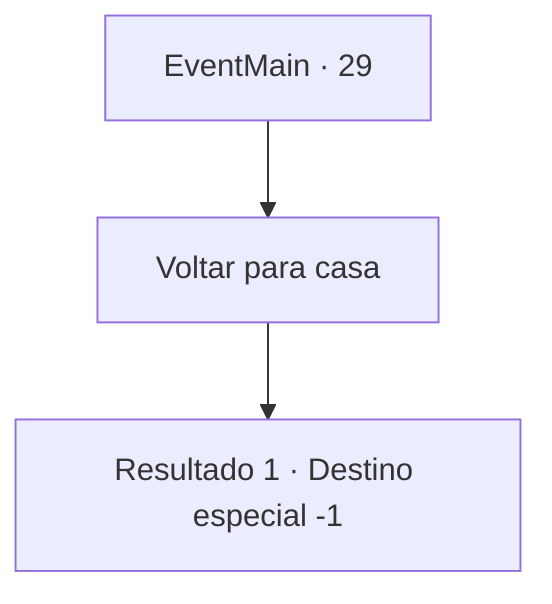

# Eventos principais · 29

[Índice da tabela](index.md) · [Índice geral](../index.md)

ID: `pt:EventMain:29` · Fonte: `EventMain4` · Versão: 1.2.47.

Mapeamento estático dos arquivos; a disponibilidade e a execução dependem do estado da run.

## Texto do evento

Sua perna piora a cada dia. Tem sido dolorido desde aquele ataque élfico, mas agora cada passo lhe dá uma dor imensa. Você conclui que este é o fim de sua aventura.

## Dados de entrada

```json
{
  "id": 29,
  "grade": 1,
  "normalGoal": "0",
  "required": "13_0_10|1_2_100"
}
```

## Mapa das escolhas



## Escolhas e resultados

### Escolha 1

Voltar para casa

Requisitos e outros campos da escolha:

```json
{
  "required": ""
}
```

#### Resultado 1.1

Você retorna à sua casa após uma longa ausência. Você falhou em se tornar o aventureiro dos seus sonhos, mas sua família está grata por ver você vivo. Seu pai lhe atualiza sobre um boato que circula pela cidade. De acordo com ele, o governo nega ter enviado pioneiros, para evitar conflito com os nativos élficos, e anunciou que responsabilizará diversos oficiais pelo incidente. Você decide se estabelecer e começar a aprender agricultura com seu pai. Sua vida como aventureiro acabou, e sua nova vida como fazendeiro apenas começou.|drawing_farm|

Continuação registrada: [Destino especial `-1`](../destinos-especiais.md).

```json
{
  "required": "",
  "chance": "1",
  "nextEvent": -1,
  "type": 2,
  "reward": "15_1_3"
}
```

## Referências que chegam a este evento

Nenhum `nextEvent` positivo da mesma tabela aponta para este nó. Isso não prova que seja inacessível: sorteio e estado de história podem selecioná-lo.

