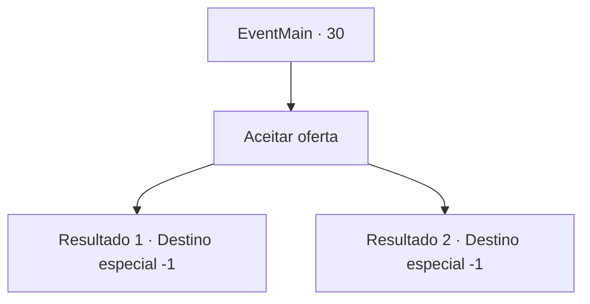

# Eventos principais · 30

[Índice da tabela](index.md) · [Índice geral](../index.md)

ID: `pt:EventMain:30` · Fonte: `EventMain4` · Versão: 1.2.47.

Mapeamento estático dos arquivos; a disponibilidade e a execução dependem do estado da run.

## Texto do evento

Os elfos cuidam de seus ferimentos após a batalha contra os pioneiros. No entanto, sua perna esquerda nunca se recupera totalmente. Você teve que deixar sua vida de aventureiro para trás. Irelle se culpou por ter te envolvido. Ele pede que você fique na vila élfica.

## Dados de entrada

```json
{
  "id": 30,
  "grade": 1,
  "normalGoal": "0",
  "required": "13_0_15|1_2_100"
}
```

## Mapa das escolhas



## Escolhas e resultados

### Escolha 1

Aceitar oferta

Requisitos e outros campos da escolha:

```json
{
  "required": ""
}
```

#### Resultado 1.1

Você é provavelmente procurado como um traidor na sua casa. Você não tem mais para onde ir, então você aceita a oferta dele. Os elfos se importam com você, e você começa a viver entre eles.

Continuação registrada: [Destino especial `-1`](../destinos-especiais.md).

```json
{
  "required": "18_8_2",
  "chance": "1",
  "nextEvent": -1,
  "type": 2,
  "reward": "15_1_5"
}
```

#### Resultado 1.2

Você traiu seu país, e agora provavelmente há uma recompensa pela sua cabeça. Além disso, você está noivando com Irelle e você pensa que seria bom viver com ele entre os elfos. Você aceita a oferta dele e começa sua vida com os elfos.

Continuação registrada: [Destino especial `-1`](../destinos-especiais.md).

```json
{
  "required": "5_8_2",
  "chance": "1",
  "nextEvent": -1,
  "type": 2,
  "reward": "15_1_5|15_1_13"
}
```

## Referências que chegam a este evento

Nenhum `nextEvent` positivo da mesma tabela aponta para este nó. Isso não prova que seja inacessível: sorteio e estado de história podem selecioná-lo.

