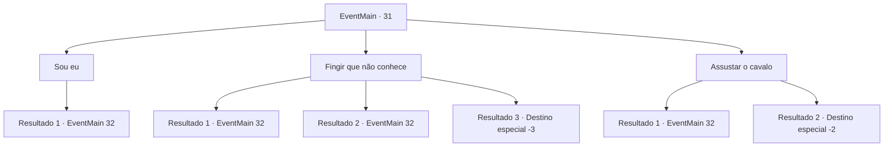

# Eventos principais · 31

[Índice da tabela](index.md) · [Índice geral](../index.md)

ID: `pt:EventMain:31` · Fonte: `EventMain4` · Versão: 1.2.47.

Mapeamento estático dos arquivos; a disponibilidade e a execução dependem do estado da run.

## Texto do evento

Alguém vem até você em um cavalo marrom. |drawing_executor| Sua barba é mais longa que seu cabelo, e ele está usando uma armadura que cobre seu torso. Ele olha para você em seu cavalo enquanto fala. 

 "Saudações. Procuro um aventureiro, um criminoso perigoso que traiu o Reino. Viu algo parecido?"


## Dados de entrada

```json
{
  "id": 31,
  "grade": 1,
  "normalGoal": "0",
  "required": "13_0_13|1_2_100"
}
```

## Mapa das escolhas



## Escolhas e resultados

### Escolha 1

Sou eu

Requisitos e outros campos da escolha:

```json
{
  "required": ""
}
```

#### Resultado 1.1

O homem desce do cavalo dele. 

 "Gosto da sua honestidade... e da doce, doce recompensa pela sua cabeça."

 Ele balança a lâmina ameaçadoramente enquanto se aproxima de você.

Continuação registrada: [Evento 32](0032.md) na mesma tabela.

```json
{
  "required": "",
  "chance": "1",
  "nextEvent": 32,
  "type": 2,
  "reward": "6_0_26",
  "place": 1
}
```

### Escolha 2

Fingir que não conhece

Requisitos e outros campos da escolha:

```json
{
  "required": ""
}
```

#### Resultado 2.1


 "Sério...? Então vamos, pelo o menos, dar uma olhada nesse pergaminho."

 Ele sorri e segura um pergaminho para você ver. Nele há um desenho do seu rosto. Através do seu pânico, a lâmina do homem voa na sua direção. Você tenta esquivar, mas é deixado com uma ferida ardente. Ele lambe o sangue da lâmina e salta do cavalo. 

 "Hehe... Eu já posso sentir o gosto da doce, doce recompensa pela sua cabeça."


Continuação registrada: [Evento 32](0032.md) na mesma tabela.

```json
{
  "required": "1_0_2",
  "chance": "17",
  "nextEvent": 32,
  "type": 1,
  "reward": "0_0_-1|6_0_26",
  "place": 1
}
```

#### Resultado 2.2


 "Sério...? Então vamos, pelo o menos, dar uma olhada nesse pergaminho."

 Ele sorri e segura um pergaminho para você ver. Nele há um desenho do seu rosto. Através do seu pânico, a lâmina do homem voa na sua direção. Você se curva para trás a tempo de esquivar. Ele salta do cavalo. 

 "Você é cheio de truques, não é? Hehe... Vamos dançar, traidor!"


Continuação registrada: [Evento 32](0032.md) na mesma tabela.

```json
{
  "required": "",
  "chance": "1|0_6_1",
  "nextEvent": 32,
  "type": 0,
  "reward": "6_0_26",
  "place": 1
}
```

#### Resultado 2.3


 "Sério...? Então vamos, pelo o menos, dar uma olhada nesse pergaminho."

 Ele sorri e segura um pergaminho para você ver. Nele há um desenho do seu rosto. Através do seu pânico, a lâmina do homem voa na sua direção. Você é morto instantaneamente.

Continuação registrada: [Destino especial `-3`](../destinos-especiais.md).

```json
{
  "required": "2_0_2",
  "chance": "15",
  "nextEvent": -3,
  "type": 1,
  "reward": "0_0_-1"
}
```

### Escolha 3

Assustar o cavalo

Requisitos e outros campos da escolha:

```json
{
  "required": ""
}
```

#### Resultado 3.1

Você tenta assustar o cavalo e conseguir algum tempo para fugir. O cavalo simplesmente bufa. O homem sorri largamente enquanto salta do cavalo.

Continuação registrada: [Evento 32](0032.md) na mesma tabela.

```json
{
  "required": "",
  "chance": "13",
  "nextEvent": 32,
  "type": 1,
  "reward": "6_3_26",
  "place": 1
}
```

#### Resultado 3.2

Você assusta o cavalo para conseguir tempo para fugir. O cavalo, surpreso, ergue suas patas dianteiras. O homem cai do cavalo. Ele aterrissa de pescoço e nunca mais se levanta. Você deixa o corpo e a vila para trás.

Continuação registrada: [Destino especial `-2`](../destinos-especiais.md).

```json
{
  "required": "",
  "chance": "1|0_12_1",
  "nextEvent": -2,
  "type": 0,
  "reward": "13_0_16"
}
```

## Referências que chegam a este evento

Nenhum `nextEvent` positivo da mesma tabela aponta para este nó. Isso não prova que seja inacessível: sorteio e estado de história podem selecioná-lo.

