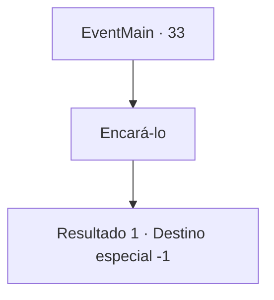

# Eventos principais · 33

[Índice da tabela](index.md) · [Índice geral](../index.md)

ID: `pt:EventMain:33` · Fonte: `EventMain4` · Versão: 1.2.47.

Mapeamento estático dos arquivos; a disponibilidade e a execução dependem do estado da run.

## Texto do evento

|drawing_camp|Como o legislador havia avisado em seu último suspiro, muitos vieram atrás de você. Você tentou se tornar um herói, mas acabou como um fugitivo. Mais virão e acharão você.

## Dados de entrada

```json
{
  "id": 33,
  "grade": 1,
  "normalGoal": "0",
  "required": "13_0_16|1_2_100"
}
```

## Mapa das escolhas



## Escolhas e resultados

### Escolha 1

Encará-lo

Requisitos e outros campos da escolha:

```json
{
  "required": ""
}
```

#### Resultado 1.1

Ele provavelmente vê você só como um punhado de dinheiro. Você não tem intenção de morrer, então você o recebe de 'braços abertos'.

Continuação registrada: [Destino especial `-1`](../destinos-especiais.md).

```json
{
  "required": "",
  "chance": "1",
  "nextEvent": -1,
  "type": 2,
  "reward": "15_1_7"
}
```

## Referências que chegam a este evento

Nenhum `nextEvent` positivo da mesma tabela aponta para este nó. Isso não prova que seja inacessível: sorteio e estado de história podem selecioná-lo.

