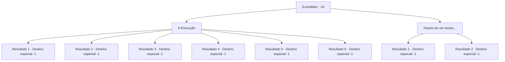

# Eventos principais · 34

[Índice da tabela](index.md) · [Índice geral](../index.md)

ID: `pt:EventMain:34` · Fonte: `EventMain4` · Versão: 1.2.47.

Mapeamento estático dos arquivos; a disponibilidade e a execução dependem do estado da run.

## Texto do evento

*Sem texto no arquivo.*

## Dados de entrada

```json
{
  "id": 34,
  "grade": 1,
  "normalGoal": "0",
  "required": "13_0_17"
}
```

## Mapa das escolhas



## Escolhas e resultados

### Escolha 1

A Execução

Requisitos e outros campos da escolha:

```json
{
  "required": "33_5_5|33_9_6"
}
```

#### Resultado 1.1

|drawing_excution|Você sobe as escadas para o andaime enquanto a multidão assiste. O laço lentamente se aperta em torno do seu pescoço. O executor levanta sua cabeça e diz. 

 "Esse traidor matou pioneiros do Reino e tentou invadí-lo a serviço dos elfos. Eu irei, assim, levar o traidor à morte."

 Você implora, mas ninguém ouve. Você é executado enquanto a multidão celebra.

Continuação registrada: [Destino especial `-1`](../destinos-especiais.md).

```json
{
  "required": "18_91_3|18_92_3|18_8_2|18_465_1|18_270_1|33_5_7",
  "chance": "1",
  "nextEvent": -1,
  "type": 2,
  "reward": "15_1_6|25_8_1"
}
```

#### Resultado 1.2

|drawing_excution|Você sobe as escadas para o andaime enquanto a multidão assiste. O laço lentamente se aperta em torno do seu pescoço. O executor levanta sua cabeça e diz. 

 "Esse traidor matou pioneiros do Reino e tentou invadí-lo a serviço dos elfos. Eu irei, assim, levar o traidor à morte."

 Você implora, mas ninguém ouve. Então, com um estrondo, fumaça preenche a praça. 

 "O que... Quem é esse?! O que está acontecendo?"

 Alguém solta você em meio ao pânico e o coloca em cima de um cavalo. O saco preto é tirado da sua cabeça e você encara seu salvador. É sua amada Majet. 

 "O que você faria sem mim, querido? Você quase me deu um ataque cardíaco. Tente tomar mais cuidado consigo mesmo..."

 Você escapa com sucesso da cena com ajuda dela.

Continuação registrada: [Destino especial `-1`](../destinos-especiais.md).

```json
{
  "required": "-1|5_91_3|5_92_3",
  "chance": "1",
  "nextEvent": -1,
  "type": 2,
  "reward": "15_1_1"
}
```

#### Resultado 1.3

|drawing_excution| Você sobe as escadas até o patíbulo enquanto a multidão observa. A corda da forca lentamente se aperta em torno do seu pescoço. O carrasco segura sua cabeça e fala. 

 "Este traidor matou pioneiros do Reino e tentou invadi-lo a serviço dos elfos. Eu agora executarei o traidor."

 Você implora, mas ninguém escuta. Naquele momento, uma sombra maciça se projeta sobre a praça, e um raio cai com um som estrondoso. <link=shake>

 "Parem! Todo mundo, parem agora mesmo!"

</link> As pessoas entram em pânico e fogem do rugido do Dragão Azul e dos raios que ele emite. Ternach, tendo esvaziado a praça, bufa e te pega, voando alto no céu.

Continuação registrada: [Destino especial `-1`](../destinos-especiais.md).

```json
{
  "required": "5_465_1",
  "chance": "1",
  "nextEvent": -1,
  "type": 2,
  "reward": "15_1_1"
}
```

#### Resultado 1.4

|drawing_excution|Você sobe as escadas para o andaime enquanto a multidão observa.  A corda aperta lentamente em torno do pescoço. O executor levanta a cabeça e fala.  

 "este traidor matou pioneiros do reino e tentou invadi-lo a serviço dos elfos. Por isso vou matar o traidor."

  Você pede, mas ninguém ouve.  Então, uma forte explosão, claramente sentida através do capô de execução, preenche a praça.  Você ouve o executor desabando no chão, e com o som de uma flecha o nó é cortado.  

 "o que ... Quem está lá! O que está acontecendo? "

  Em meio ao pânico, alguém agarra sua mão e puxa você para cima.  Você tira o capô de execução. Você pode reconhecer claramente aquele que está puxando sua mão, mesmo com o manto cinza que ele está vestindo.  É Irelle, seu amante. Com sua ajuda você foi capaz de escapar da execução.

Continuação registrada: [Destino especial `-1`](../destinos-especiais.md).

```json
{
  "required": "5_8_2",
  "chance": "1",
  "nextEvent": -1,
  "type": 2,
  "reward": "15_1_5|15_1_13"
}
```

#### Resultado 1.5

|drawing_excution| Você vai em direção a forca, enquanto uma grande audiência está assistindo.  Você sente a corda apertando em torno de seu pescoço. O executor segura sua cabeça e fala. 

 "Este traidor se dediu aos elfos, assassinou nossos pioneiros e tentou invadir o reino! Eu continuo pela frase de morte."

  Você implica para sua inocência, mas ninguém o escuta. Então, você ouve os sons de risos. 

 "Gahahaha! Eu, 'Van Goyle', levará esse pintado aqui a partir de hoje!"

 Você percebe quem o falante é.  Você ouve o som das espadas que se chocam, e alguém corta a corda em volta do pescoço e coloca você em um cavalo em meio ao pânico.  Quando você toma o capuz da execução, você percebe que seu Salvador é, como você esperava, seu amante Benjamin. Ele Nad seus amigos ordena que seus cavalos sejam executados.  Todos estão usando máscaras. Alguém faz uma piada e todos começa a rir. 

 "Resgatando uma donzela em sofrimento, agora é o que eu chamo de cavalheiro"


Continuação registrada: [Destino especial `-1`](../destinos-especiais.md).

```json
{
  "required": "5_270_1",
  "chance": "1",
  "nextEvent": -1,
  "type": 2,
  "reward": "15_1_1"
}
```

#### Resultado 1.6

|drawing_excution|Você sobe as escadas para o andaime enquanto a multidão assiste. O laço lentamente se aperta em torno do seu pescoço. O executor levanta sua cabeça e diz. 

 "Esse traidor matou pioneiros do Reino e tentou invadí-lo a serviço dos elfos. Eu irei, assim, levar o traidor à morte."

 Você implora, mas ninguém ouve. Você é executado enquanto a multidão celebra.

Continuação registrada: [Destino especial `-1`](../destinos-especiais.md).

```json
{
  "required": "-1|31_5_7|31_5_8",
  "chance": "1",
  "nextEvent": -1,
  "type": 2,
  "reward": "15_1_6|25_8_1"
}
```

### Escolha 2

Depois de um tempo...

Requisitos e outros campos da escolha:

```json
{
  "required": "-1|31_5_5|31_9_6"
}
```

#### Resultado 2.1

Você é condenado à morte, e vários dias se passam. Estando trancado em uma cela solitária, você não consegue dizer a data exata. Então, um guarda da prisão abre a porta da sua cela. 

 "Saia."

 Você levanta a cabeça para olhá-lo. Seus olhos parecem estar olhando não para você, mas para algum lugar atrás de você. Percebendo algo estranho, uma cauda de demônio familiar aparece diante de você. Cira se revela por trás do guarda. Ela sorri maliciosamente e diz. 

 "Senti minha falta? Venha rápido. Vamos embora."

 Você pega a mão dela. E juntos, vocês escapam da prisão.

Continuação registrada: [Destino especial `-1`](../destinos-especiais.md).

```json
{
  "required": "31_5_5",
  "chance": "1",
  "nextEvent": -1,
  "type": 2,
  "reward": "15_1_5"
}
```

#### Resultado 2.2

Você é condenado à morte, e vários dias se passam. Estando trancado em uma cela solitária, você não consegue dizer a data exata. Então, um guarda da prisão abre a porta da sua cela. 

 "Saia."

 Você levanta a cabeça para olhá-lo. Ao seu lado estão anões armados com aço. Um dos anões fala. 

 "Hum. A senhora exerceu seu poder. Vamos juntos."

 Parece que Sartha usou algum tipo de truque para te tirar de lá. Você sai da prisão com os anões.

Continuação registrada: [Destino especial `-1`](../destinos-especiais.md).

```json
{
  "required": "31_9_6",
  "chance": "1",
  "nextEvent": -1,
  "type": 2,
  "reward": "15_1_5|14_9_6"
}
```

## Referências que chegam a este evento

- [Evento 25 · escolha 2 · resultado 1](0025.md#escolha-2)
- [Evento 32 · escolha 2 · resultado 1](0032.md#escolha-2)
