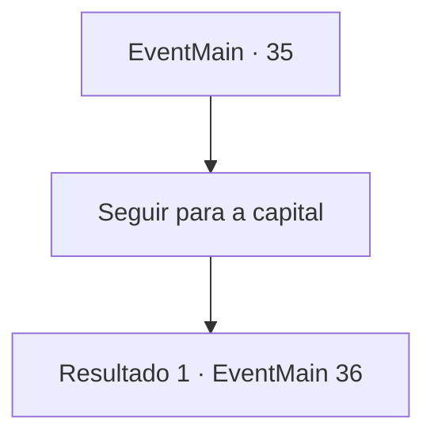

# Eventos principais · 35

[Índice da tabela](index.md) · [Índice geral](../index.md)

ID: `pt:EventMain:35` · Fonte: `EventMain4` · Versão: 1.2.47.

Mapeamento estático dos arquivos; a disponibilidade e a execução dependem do estado da run.

## Texto do evento

Você passa pelo acampamento dos pioneiros para examinar seu equipamento. Os pioneiros aumentaram em número após a vitória contra os elfos, e o acampamento agora é grande o suficiente para ser uma cidade. 

 " {1}! É um prazer finalmente te conhecer."

 Um homem em um terno azul marinho se aproxima de você. Ele se apresenta como mensageiro e lhe entrega uma carta com o selo do Rei. |drawing_kingsMessenger| A carta fala de uma decisão de colocar as fronteiras sob a dependência de um Barão, e pergunta se você pode assumir a posição. O mensageiro ajusta seu monóculo e fala. 

 "O levarei para a capital, Barão {1}."


## Dados de entrada

```json
{
  "id": 35,
  "grade": 1,
  "normalGoal": "0",
  "required": "1_2_100|13_0_8"
}
```

## Mapa das escolhas



## Escolhas e resultados

### Escolha 1

Seguir para a capital

Requisitos e outros campos da escolha:

```json
{
  "required": ""
}
```

#### Resultado 1.1

Você viaja de volta para a capital com o mensageiro em uma diligência. Ao atravessar As montanhas Atilante, você vê os restos do gigante da geada do lado de fora da janela. O mensageiro olha para ele maravilhado. 

 "olhe lá, barão. Não é gigantesco? Quem poderia ter matado algo assim ..."


Continuação registrada: [Evento 36](0036.md) na mesma tabela.

```json
{
  "required": "",
  "chance": "1",
  "nextEvent": 36,
  "type": 2,
  "reward": ""
}
```

## Referências que chegam a este evento

Nenhum `nextEvent` positivo da mesma tabela aponta para este nó. Isso não prova que seja inacessível: sorteio e estado de história podem selecioná-lo.

