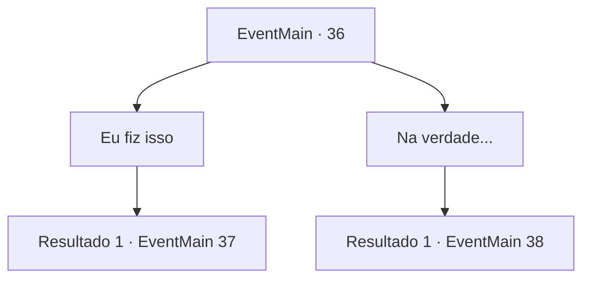

# Eventos principais · 36

[Índice da tabela](index.md) · [Índice geral](../index.md)

ID: `pt:EventMain:36` · Fonte: `EventMain4` · Versão: 1.2.47.

Mapeamento estático dos arquivos; a disponibilidade e a execução dependem do estado da run.

## Texto do evento

*Sem texto no arquivo.*

## Dados de entrada

```json
{
  "id": 36,
  "grade": 1,
  "normalGoal": "0",
  "required": ""
}
```

## Mapa das escolhas



## Escolhas e resultados

### Escolha 1

Eu fiz isso

Requisitos e outros campos da escolha:

```json
{
  "required": ""
}
```

#### Resultado 1.1

Você conta a ele sobre sua batalha com o gigante do gelo, enquanto toma algumas liberdades criativas. O mensageiro escuta com admiração. 

 "Excelente... Você enfrentou um gigante e um elfo..."

 Ele pega um pequeno caderno e escreve algo antes de guardá-lo novamente. Você chega à capital alguns dias depois. O mensageiro explica sobre sua cerimônia de enobrecimento e vai embora.

Continuação registrada: [Evento 37](0037.md) na mesma tabela.

```json
{
  "required": "",
  "chance": "1",
  "nextEvent": 37,
  "type": 2,
  "reward": ""
}
```

### Escolha 2

Na verdade...

Requisitos e outros campos da escolha:

```json
{
  "required": ""
}
```

#### Resultado 2.1

Você conta a história completa da sua batalha com o gigante do gelo. 

 "Entendo. Então elfos parecem ajudar os humanos às vezes. Em raras ocasiões, eu presumo."

 Você chega à capital alguns dias depois. O mensageiro explica sobre sua cerimônia de enobrecimento e vai embora.

Continuação registrada: [Evento 38](0038.md) na mesma tabela.

```json
{
  "required": "",
  "chance": "1",
  "nextEvent": 38,
  "type": 2,
  "reward": ""
}
```

## Referências que chegam a este evento

- [Evento 35 · escolha 1 · resultado 1](0035.md#escolha-1)
