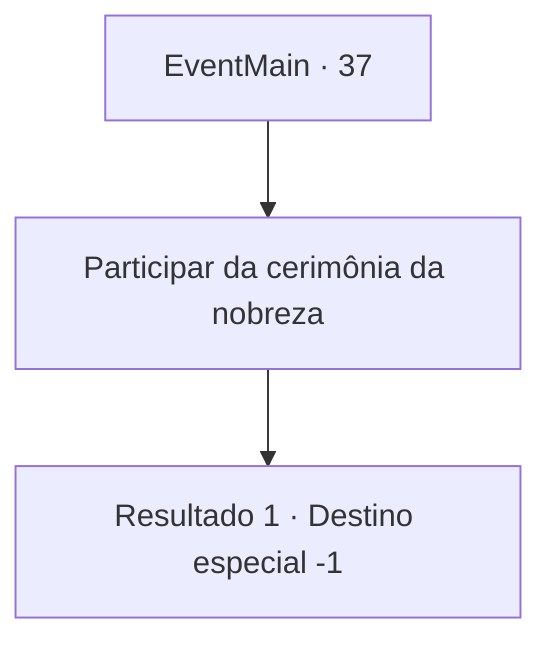

# Eventos principais · 37

[Índice da tabela](index.md) · [Índice geral](../index.md)

ID: `pt:EventMain:37` · Fonte: `EventMain4` · Versão: 1.2.47.

Mapeamento estático dos arquivos; a disponibilidade e a execução dependem do estado da run.

## Texto do evento

*Sem texto no arquivo.*

## Dados de entrada

```json
{
  "id": 37,
  "grade": 1,
  "normalGoal": "0",
  "required": ""
}
```

## Mapa das escolhas



## Escolhas e resultados

### Escolha 1

Participar da cerimônia da nobreza

Requisitos e outros campos da escolha:

```json
{
  "required": ""
}
```

#### Resultado 1.1

Sons majestosos de trombetas enchem a praça enquanto muitos assistem, e o anfitrião lhe dá as boas-vindas na plataforma. 

 "Uma rodada de aplausos para o Matador de Gigantes e Elfos!"

 As pessoas comemoram e aplaudem. Você sobe na plataforma e lentamente se ajoelha diante do rei. O rei olha para você e fala. 

 "Todos aqui se lembrarão de suas aventuras. Eles cantarão sobre sua bravura pelos próximos anos. Eu o nomeio Barão da Fronteira."

 Ele encara o povo e grita. 

 "Contemplem! O herói do nosso Reino!"|drawing_prizeMe| A multidão comemora estrondosamente.

Continuação registrada: [Destino especial `-1`](../destinos-especiais.md).

```json
{
  "required": "",
  "chance": "1",
  "nextEvent": -1,
  "type": 2,
  "reward": "15_1_0"
}
```

## Referências que chegam a este evento

- [Evento 36 · escolha 1 · resultado 1](0036.md#escolha-1)
