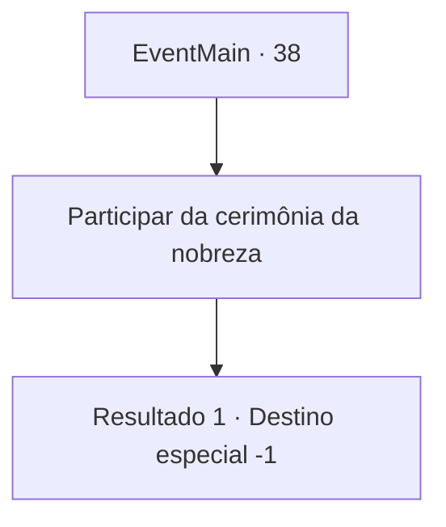

# Eventos principais · 38

[Índice da tabela](index.md) · [Índice geral](../index.md)

ID: `pt:EventMain:38` · Fonte: `EventMain4` · Versão: 1.2.47.

Mapeamento estático dos arquivos; a disponibilidade e a execução dependem do estado da run.

## Texto do evento

*Sem texto no arquivo.*

## Dados de entrada

```json
{
  "id": 38,
  "grade": 1,
  "normalGoal": "0",
  "required": ""
}
```

## Mapa das escolhas



## Escolhas e resultados

### Escolha 1

Participar da cerimônia da nobreza

Requisitos e outros campos da escolha:

```json
{
  "required": ""
}
```

#### Resultado 1.1

O som da trombeta majestosa enche a praça enquanto muitos assistem, E o anfitrião recebe você até a plataforma. 

 "Uma rodada de aplausos para o Herói dos Pioneiros! "

 As pessoas aplaudem e aplaudem. Você sobe para a plataforma, e lentamente ajoelha-se diante do rei. O rei olha para você e fala. 

 "todos aqui vão se lembrar de suas aventuras. Eles vão cantar de sua bravura nos próximos anos. Eu por isso o nomeio barão da fronteira."

 Ele enfrenta as pessoas e grita. 

 "Eis que! O herói do nosso reino!"|drawing_prizeMe| A Multidão comemora estrondosamente.

Continuação registrada: [Destino especial `-1`](../destinos-especiais.md).

```json
{
  "required": "",
  "chance": "1",
  "nextEvent": -1,
  "type": 2,
  "reward": "15_1_0"
}
```

## Referências que chegam a este evento

- [Evento 36 · escolha 2 · resultado 1](0036.md#escolha-2)
