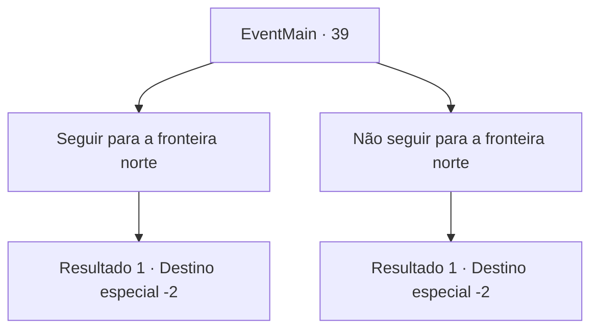

# Eventos principais · 39

[Índice da tabela](index.md) · [Índice geral](../index.md)

ID: `pt:EventMain:39` · Fonte: `EventMain4` · Versão: 1.2.47.

Mapeamento estático dos arquivos; a disponibilidade e a execução dependem do estado da run.

## Texto do evento

|drawing_ridingMessenger| Um dia, um mensageiro vem às pressas a cavalo. Ele lhe entrega um pergaminho com o selo real. Ele fala de um conflito armado entre elfos e pioneiros na fronteira norte além das Montanhas Atilante. O Reino está convocando tropas para ajudar os pioneiros.

## Dados de entrada

```json
{
  "id": 39,
  "grade": 1,
  "normalGoal": "0",
  "required": "13_0_18|1_2_45"
}
```

## Mapa das escolhas



## Escolhas e resultados

### Escolha 1

Seguir para a fronteira norte

Requisitos e outros campos da escolha:

```json
{
  "required": ""
}
```

#### Resultado 1.1

Você responde ao chamado de dever e levanta a cabeça para o campo pioneiro além das montanhas de Atilante.

Continuação registrada: [Destino especial `-2`](../destinos-especiais.md).

```json
{
  "required": "",
  "chance": "1",
  "nextEvent": -2,
  "type": 2,
  "reward": "13_0_19|0_2_1"
}
```

### Escolha 2

Não seguir para a fronteira norte

Requisitos e outros campos da escolha:

```json
{
  "required": ""
}
```

#### Resultado 2.1

Você age como se estivesse tomando o pergaminho, e joga-o na grama.  Então você procede a caminhar para a direção oposta do referido assentamento.

Continuação registrada: [Destino especial `-2`](../destinos-especiais.md).

```json
{
  "required": "",
  "chance": "1",
  "nextEvent": -2,
  "type": 2,
  "reward": "13_0_27"
}
```

## Referências que chegam a este evento

Nenhum `nextEvent` positivo da mesma tabela aponta para este nó. Isso não prova que seja inacessível: sorteio e estado de história podem selecioná-lo.

