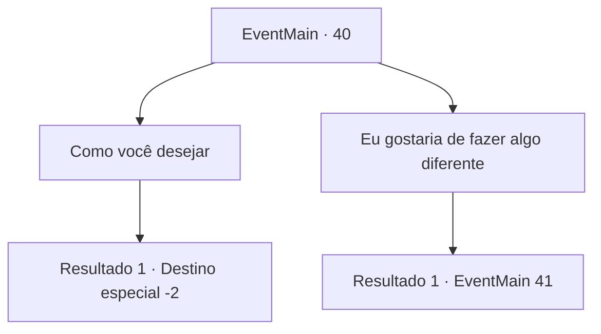

# Eventos principais · 40

[Índice da tabela](index.md) · [Índice geral](../index.md)

ID: `pt:EventMain:40` · Fonte: `EventMain4` · Versão: 1.2.47.

Mapeamento estático dos arquivos; a disponibilidade e a execução dependem do estado da run.

## Texto do evento

Você chega ao acampamento pioneiro e encontra um grande número de tropas que vieram auxiliar. Fazendeiros, mercadores, aventureiros... qualquer homem que possa empunhar uma espada está presente. Um homem sobe no pódio em meio à confusão. |drawing_commander| 

 "Saudações, cavalheiros. Eu sou seu comandantem, Conde Jimradi."

 Ele nos dá as boas-vindas antes de nos dividir em grupos com diferentes papéis. Então ele se aproxima de mim e fala. 

 "Ah, eu ouvi seu nome várias vezes. Tenho uma tarefa especial para você. Eu gostaria que você distraísse os inimigos por trás de suas linhas para que possamos pressioná-los melhor."


## Dados de entrada

```json
{
  "id": 40,
  "grade": 1,
  "normalGoal": "0",
  "required": "13_0_19|1_2_60"
}
```

## Mapa das escolhas



## Escolhas e resultados

### Escolha 1

Como você desejar

Requisitos e outros campos da escolha:

```json
{
  "required": ""
}
```

#### Resultado 1.1

Ele sorri satisfeito e assente.  

 "Eu aprecio seu vigor. Aqui estão as informações que nossos pioneiros e batedores reuniram."

  Ele pega um pergaminho e entrega para você.  Ele contém informações sobre seu alvo e um mapa detalhando seu caminho.  Você embolsa o pergaminho e sai.

Continuação registrada: [Destino especial `-2`](../destinos-especiais.md).

```json
{
  "required": "",
  "chance": "1",
  "nextEvent": -2,
  "type": 2,
  "reward": "3_131_1|13_0_20|0_2_2"
}
```

### Escolha 2

Eu gostaria de fazer algo diferente

Requisitos e outros campos da escolha:

```json
{
  "required": ""
}
```

#### Resultado 2.1

Jimradi cruza os braços e considera sua resposta antes de falar.  

 "Muito bem. Eu gostaria que você fosse um dos nossos centuriões. Você tem o que é preciso, eu posso dizer."

  Ele abre um mapa e explica seu plano para você e outros 9 centuriões.  Envolve mover-se pela floresta depois de escurecer e ir direto para o acampamento base.  

 "Começaremos às 4 da manhã. Certifique-se de se preparar."


Continuação registrada: [Evento 41](0041.md) na mesma tabela.

```json
{
  "required": "",
  "chance": "1",
  "nextEvent": 41,
  "type": 2,
  "reward": ""
}
```

## Referências que chegam a este evento

Nenhum `nextEvent` positivo da mesma tabela aponta para este nó. Isso não prova que seja inacessível: sorteio e estado de história podem selecioná-lo.

