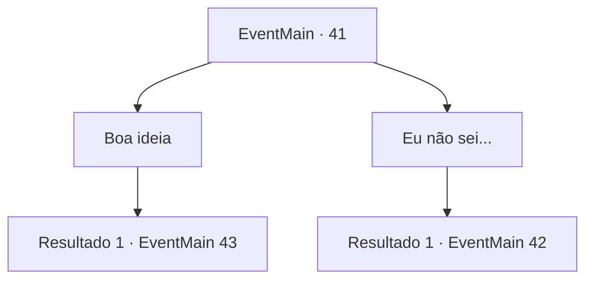

# Eventos principais · 41

[Índice da tabela](index.md) · [Índice geral](../index.md)

ID: `pt:EventMain:41` · Fonte: `EventMain4` · Versão: 1.2.47.

Mapeamento estático dos arquivos; a disponibilidade e a execução dependem do estado da run.

## Texto do evento

*Sem texto no arquivo.*

## Dados de entrada

```json
{
  "id": 41,
  "grade": 1,
  "normalGoal": "0",
  "required": ""
}
```

## Mapa das escolhas



## Escolhas e resultados

### Escolha 1

Boa ideia

Requisitos e outros campos da escolha:

```json
{
  "required": ""
}
```

#### Resultado 1.1

Você concorda entusiasticamente com o plano do Conde.  Os outros centuriões acenam com a cabeça e voltam para suas unidades.  

  A lua brilha na noite.
  10 centuriões se aproximam da vila élfica através da floresta.  A floresta é estreita e rochosa, então os soldados viajam em filas de dois.  

 "Essas orelhas compridas nem nos verão chegando."

  Jimradi diz com um sorriso triunfante.  Mas assim que ele termina sua frase, flechas voam em nossa direção do escuro.  Você ouve gritos à esquerda e à direita enquanto tropas aterrorizadas pisam em seus companheiros caídos para fugir.  E da escuridão emergem os elfos.

Continuação registrada: [Evento 43](0043.md) na mesma tabela.

```json
{
  "required": "",
  "chance": "1",
  "nextEvent": 43,
  "type": 2,
  "reward": "6_3_59|0_2_2",
  "place": 1
}
```

### Escolha 2

Eu não sei...

Requisitos e outros campos da escolha:

```json
{
  "required": ""
}
```

#### Resultado 2.1

Você questiona as táticas do comandante.  Ele te encara e fala.  

 "Huh... parece que nosso aventureiro aqui sabe mais sobre o campo de batalha do que nós, veteranos. Vá em frente, fale o que pensa."


Continuação registrada: [Evento 42](0042.md) na mesma tabela.

```json
{
  "required": "",
  "chance": "1",
  "nextEvent": 42,
  "type": 2,
  "reward": ""
}
```

## Referências que chegam a este evento

- [Evento 40 · escolha 2 · resultado 1](0040.md#escolha-2)
