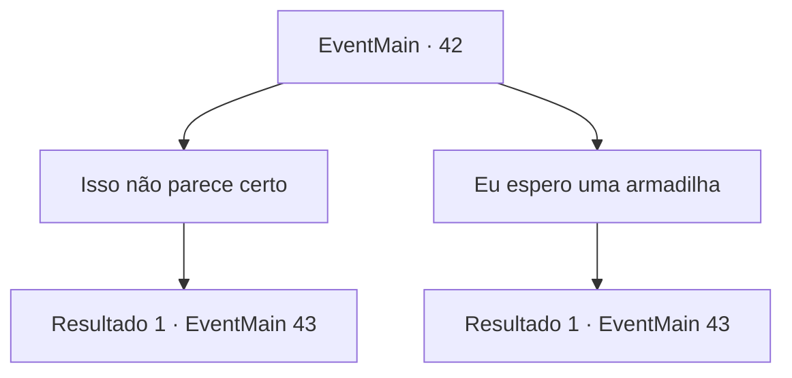

# Eventos principais · 42

[Índice da tabela](index.md) · [Índice geral](../index.md)

ID: `pt:EventMain:42` · Fonte: `EventMain4` · Versão: 1.2.47.

Mapeamento estático dos arquivos; a disponibilidade e a execução dependem do estado da run.

## Texto do evento

*Sem texto no arquivo.*

## Dados de entrada

```json
{
  "id": 42,
  "grade": 1,
  "normalGoal": "0",
  "required": ""
}
```

## Mapa das escolhas



## Escolhas e resultados

### Escolha 1

Isso não parece certo

Requisitos e outros campos da escolha:

```json
{
  "required": ""
}
```

#### Resultado 1.1

Quando ele disse que não se sentia bem, ele bufou.  Depois foi para o seu quartel, deixando um recado para se preparar de acordo com a operação original.  Os outros centuriões também assentiram e voltaram para suas respectivas unidades.  

  Amanheceu quando todos estavam dormindo.
  Cento e dez homens seguiram a estrada da floresta até a aldeia dos elfos.  A estrada da floresta era estreita e áspera, então os soldados andavam em longas filas em duas fileiras.  

 "Os de orelhas grandes nem vão sonhar que vamos surpreendê-los."

  O Conde Jimradi sorriu triunfante.  Mas assim que ele terminou de falar, flechas voaram da escuridão.  Uma enxurrada irrompeu por toda parte, e os soldados ficaram aterrorizados e correram a desesperados, pisando nos cadáveres de seus camaradas.  E os elfos saíram da floresta escura

Continuação registrada: [Evento 43](0043.md) na mesma tabela.

```json
{
  "required": "",
  "chance": "1",
  "nextEvent": 43,
  "type": 2,
  "reward": "6_3_59|0_2_2",
  "place": 1
}
```

### Escolha 2

Eu espero uma armadilha

Requisitos e outros campos da escolha:

```json
{
  "required": ""
}
```

#### Resultado 2.1

O conde responde cinicamente:  

 "Uma emboscada? Ah! Não temos nada a temer. Deixe-os vir até nós!"

  Ele ordena que todos se preparem de acordo com o plano e volta para sua tenda.  Os outros centuriões acenam com a cabeça e voltam para suas unidades.  

  A lua brilha na noite.
  10 centuriões se aproximam da vila élfica através da floresta.  A floresta é estreita e rochosa, então os soldados viajam em filas de dois.  

 "Essas orelhas compridas nem nos verão chegando."

  Jimradi diz com um sorriso triunfante.  Mas assim que ele termina sua frase, flechas voam em nossa direção do escuro.  Você ouve gritos à esquerda e à direita enquanto tropas aterrorizadas pisam em seus companheiros caídos para fugir.  E da escuridão emergem os elfos.

Continuação registrada: [Evento 43](0043.md) na mesma tabela.

```json
{
  "required": "",
  "chance": "1",
  "nextEvent": 43,
  "type": 2,
  "reward": "6_3_59|0_2_2",
  "place": 1
}
```

## Referências que chegam a este evento

- [Evento 41 · escolha 2 · resultado 1](0041.md#escolha-2)
