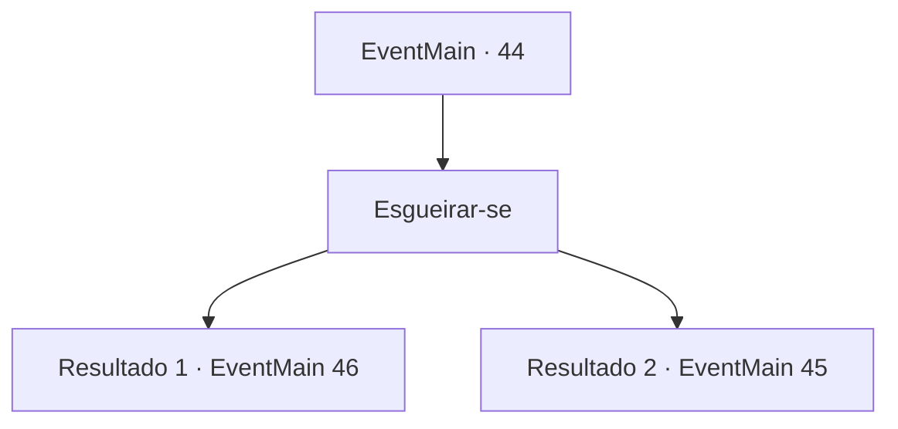

# Eventos principais · 44

[Índice da tabela](index.md) · [Índice geral](../index.md)

ID: `pt:EventMain:44` · Fonte: `EventMain4` · Versão: 1.2.47.

Mapeamento estático dos arquivos; a disponibilidade e a execução dependem do estado da run.

## Texto do evento

Você segue as instruções no mapa e chega à um acampamento élfico. Élfos Armados estão em guarda, e no meio você vê uma tenda grande. E aparenta pertencer ao comandante Élfico.

## Dados de entrada

```json
{
  "id": 44,
  "grade": 1,
  "normalGoal": "",
  "required": "13_0_20"
}
```

## Mapa das escolhas



## Escolhas e resultados

### Escolha 1

Esgueirar-se

Requisitos e outros campos da escolha:

```json
{
  "required": ""
}
```

#### Resultado 1.1

Você se esgueira em direção à tenda através dos guardas.  Mas um deles vê você.  Você decide eliminá-lo antes que ele chame os outros.

Continuação registrada: [Evento 46](0046.md) na mesma tabela.

```json
{
  "required": "",
  "chance": "15",
  "nextEvent": 46,
  "type": 1,
  "reward": "6_0_59",
  "place": 1
}
```

#### Resultado 1.2

Você observa e aprende as rotinas dos guardas. Então você manobra ao redor deles e entra na tenda. O comandante élfico está sentado em sua mesa lendo um mapa, provavelmente repensando estratégias.

Continuação registrada: [Evento 45](0045.md) na mesma tabela.

```json
{
  "required": "",
  "chance": "1|0_7_1",
  "nextEvent": 45,
  "type": 0,
  "reward": "0_2_1"
}
```

## Referências que chegam a este evento

Nenhum `nextEvent` positivo da mesma tabela aponta para este nó. Isso não prova que seja inacessível: sorteio e estado de história podem selecioná-lo.

