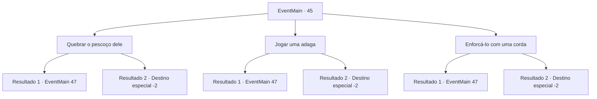

# Eventos principais · 45

[Índice da tabela](index.md) · [Índice geral](../index.md)

ID: `pt:EventMain:45` · Fonte: `EventMain4` · Versão: 1.2.47.

Mapeamento estático dos arquivos; a disponibilidade e a execução dependem do estado da run.

## Texto do evento

*Sem texto no arquivo.*

## Dados de entrada

```json
{
  "id": 45,
  "grade": 1,
  "normalGoal": "",
  "required": ""
}
```

## Mapa das escolhas



## Escolhas e resultados

### Escolha 1

Quebrar o pescoço dele

Requisitos e outros campos da escolha:

```json
{
  "required": ""
}
```

#### Resultado 1.1

Você se esgueira por trás e envolve seus braços em volta do pescoço dele.  O comandante é pego de surpresa, mas logo se solta e te joga no chão.  

 "Vejo que um rato encontrou seu caminho..."

  Ele desembainha sua espada, vermelho de raiva.  Você se levanta e pega sua arma.

Continuação registrada: [Evento 47](0047.md) na mesma tabela.

```json
{
  "required": "",
  "chance": "17",
  "nextEvent": 47,
  "type": 1,
  "reward": "6_0_58",
  "place": 1
}
```

#### Resultado 1.2

Você se esgueira por trás e envolve seus braços em volta do pescoço dele. Então você dá uma quebra rapidamente.
 <link=shake>*Crack!*</link>
 Você ouve o som arrepiante de seu pescoço quebrando enquanto ele fica mole. Você saqueia o comandante élfico e incendeia a tenda com uma lanterna sobre a mesa. O fogo se espalha rapidamente e elfos assustados desocupam o acampamento.

Continuação registrada: [Destino especial `-2`](../destinos-especiais.md).

```json
{
  "required": "",
  "chance": "1|0_5_1",
  "nextEvent": -2,
  "type": 0,
  "reward": "13_0_22|0_2_2|0_3_-5|3_104_1|3_76_1"
}
```

### Escolha 2

Jogar uma adaga

Requisitos e outros campos da escolha:

```json
{
  "required": ""
}
```

#### Resultado 2.1

Você pega uma adaga nas proximidades.  Você joga na parte de trás da cabeça dele.  Mas erra, apenas roçando sua cabeça.  O comandante élfico é pego de surpresa, mas logo saca sua lâmina.

Continuação registrada: [Evento 47](0047.md) na mesma tabela.

```json
{
  "required": "",
  "chance": "17",
  "nextEvent": 47,
  "type": 1,
  "reward": "6_0_58",
  "place": 1
}
```

#### Resultado 2.2

Você pega uma adaga nas proximidades.  Você joga na parte de trás da cabeça dele.  Ele perfura direto no crânio, e ele cai no chão.  Você saqueia o comandante élfico e incendeia a tenda com uma lanterna sobre a mesa.  O fogo se espalha rapidamente e elfos assustados desocupam o acampamento.

Continuação registrada: [Destino especial `-2`](../destinos-especiais.md).

```json
{
  "required": "",
  "chance": "1|0_6_1",
  "nextEvent": -2,
  "type": 0,
  "reward": "13_0_22|0_2_2|0_3_-5|3_104_1|3_76_1"
}
```

### Escolha 3

Enforcá-lo com uma corda

Requisitos e outros campos da escolha:

```json
{
  "required": "8_39_1"
}
```

#### Resultado 3.1

Você corre para ele por trás e amarra uma corda em seu pescoço.  O comandante élfico é pego de surpresa, mas logo quebra a corda usando seu poder bruto.  

 "Vejo que um rato encontrou seu caminho..."

  Ele desembainha sua espada, fumegando de raiva.

Continuação registrada: [Evento 47](0047.md) na mesma tabela.

```json
{
  "required": "",
  "chance": "11",
  "nextEvent": 47,
  "type": 1,
  "reward": "4_39_1|6_0_58",
  "place": 1
}
```

#### Resultado 3.2

Você se esgueira por trás e amarra a corda no pescoço dele.  <link=shake>

 "Argh...ugh...!"

</link>  Ele torce e gira enquanto tenta se libertar, mas logo fica mole.  Você saqueia o comandante élfico e incendeia a tenda com uma lanterna sobre a mesa.  O fogo se espalha rapidamente, enquanto elfos assustados desocupam o acampamento.

Continuação registrada: [Destino especial `-2`](../destinos-especiais.md).

```json
{
  "required": "",
  "chance": "1|0_5_1",
  "nextEvent": -2,
  "type": 0,
  "reward": "4_39_1|13_0_22|0_2_2|0_3_-5|3_104_1|3_76_1"
}
```

## Referências que chegam a este evento

- [Evento 44 · escolha 1 · resultado 2](0044.md#escolha-1)
- [Evento 46 · escolha 1 · resultado 1](0046.md#escolha-1)
