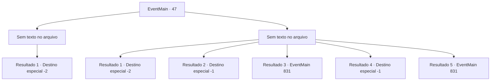

# Eventos principais · 47

[Índice da tabela](index.md) · [Índice geral](../index.md)

ID: `pt:EventMain:47` · Fonte: `EventMain4` · Versão: 1.2.47.

Mapeamento estático dos arquivos; a disponibilidade e a execução dependem do estado da run.

## Texto do evento

*Sem texto no arquivo.*

## Dados de entrada

```json
{
  "id": 47,
  "grade": 1,
  "normalGoal": "",
  "required": ""
}
```

## Mapa das escolhas



## Escolhas e resultados

### Escolha 1

*Sem texto no arquivo; o papel dessa opção depende da interface do jogo.*

Requisitos e outros campos da escolha:

```json
{
  "required": ""
}
```

#### Resultado 1.1

Você matou o comandante élfico.  Você ouve elfos se aproximando da tenda quando você está prestes a saquear seu cadáver.  Você pega a espada dele e incendeia a barraca com uma lanterna na mesa.  O fogo se espalha rapidamente e você deixa o acampamento enquanto os elfos entram em pânico.

Continuação registrada: [Destino especial `-2`](../destinos-especiais.md).

```json
{
  "required": "",
  "chance": "1",
  "nextEvent": -2,
  "type": 2,
  "reward": "13_0_22|0_3_-5|3_76_1"
}
```

### Escolha 2

*Sem texto no arquivo; o papel dessa opção depende da interface do jogo.*

Requisitos e outros campos da escolha:

```json
{
  "required": ""
}
```

#### Resultado 2.1

Você perde miseravelmente e mal consegue escapar com vida.  Então você dá um jeito nas suas feridas e volta para o acampamento dos pioneiros.

Continuação registrada: [Destino especial `-2`](../destinos-especiais.md).

```json
{
  "required": "1_0_2|1_1_2",
  "chance": "1",
  "nextEvent": -2,
  "type": 2,
  "reward": "13_0_23|0_0_-1|0_1_-1|0_2_1"
}
```

#### Resultado 2.2

Você perde miseravelmente e cai no chão.  O comandante élfico ordena que os soldados prendam e prendam você.  Você espera que outros negociem com os elfos e o libertem,  mas as coisas não saem exatamento como o esperado.

Continuação registrada: [Destino especial `-1`](../destinos-especiais.md).

```json
{
  "required": "2_0_2|24_1_1",
  "chance": "1",
  "nextEvent": -1,
  "type": 2,
  "reward": "15_1_8"
}
```

#### Resultado 2.3

Você perde miseravelmente e cai no chão.  O comandante élfico ordena que os soldados prendam e prendam você.  Você espera que outros negociem com os elfos e o libertem,  mas as coisas não saem exatamento como o esperado.

Continuação registrada: [Evento 831](0831.md) na mesma tabela.

```json
{
  "required": "2_0_2|23_1_1",
  "chance": "1",
  "nextEvent": 831,
  "type": 2,
  "reward": ""
}
```

#### Resultado 2.4

Você perde miseravelmente e cai no chão.  O comandante élfico ordena que os soldados prendam e prendam você.  Você espera que outros negociem com os elfos e o libertem,  mas as coisas não saem exatamento como o esperado.

Continuação registrada: [Destino especial `-1`](../destinos-especiais.md).

```json
{
  "required": "2_1_2|24_1_1",
  "chance": "1",
  "nextEvent": -1,
  "type": 2,
  "reward": "15_1_8"
}
```

#### Resultado 2.5

Você perde miseravelmente e cai no chão.  O comandante élfico ordena que os soldados prendam e prendam você.  Você espera que outros negociem com os elfos e o libertem,  mas as coisas não saem exatamento como o esperado.

Continuação registrada: [Evento 831](0831.md) na mesma tabela.

```json
{
  "required": "2_1_2|23_1_1",
  "chance": "1",
  "nextEvent": 831,
  "type": 2,
  "reward": ""
}
```

## Referências que chegam a este evento

- [Evento 45 · escolha 1 · resultado 1](0045.md#escolha-1)
- [Evento 45 · escolha 2 · resultado 1](0045.md#escolha-2)
- [Evento 45 · escolha 3 · resultado 1](0045.md#escolha-3)
