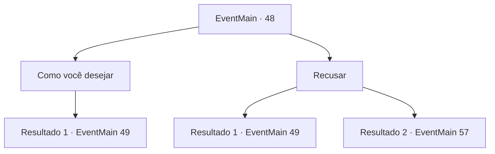

# Eventos principais · 48

[Índice da tabela](index.md) · [Índice geral](../index.md)

ID: `pt:EventMain:48` · Fonte: `EventMain4` · Versão: 1.2.47.

Mapeamento estático dos arquivos; a disponibilidade e a execução dependem do estado da run.

## Texto do evento

Você retorna ao acampamento, tendo completado com sucesso o pedido do Conde Jimradi. Jimradi está muito satisfeito com seu relatório. 

 "Haha! Eu sabia que tinha olho para homens competentes! Você de fato tirou muito peso dos meus ombros."

 Então ele pede mais uma coisa. Ele quer você ataque as forças élficas que cruzam o 'Vale dos Ventos Negros' imediatamente.

## Dados de entrada

```json
{
  "id": 48,
  "grade": 1,
  "normalGoal": "",
  "required": "13_0_22|1_2_75"
}
```

## Mapa das escolhas



## Escolhas e resultados

### Escolha 1

Como você desejar

Requisitos e outros campos da escolha:

```json
{
  "required": ""
}
```

#### Resultado 1.1

Você imediatamente lidera suas tropas para o vale.  Você chega algumas horas depois  e esconde-se em arbustos e árvores.  Forças élficas aparecem pouco depois.  Eles parecem estar transportando suprimentos.

Continuação registrada: [Evento 49](0049.md) na mesma tabela.

```json
{
  "required": "",
  "chance": "1",
  "nextEvent": 49,
  "type": 2,
  "reward": "0_2_1"
}
```

### Escolha 2

Recusar

Requisitos e outros campos da escolha:

```json
{
  "required": ""
}
```

#### Resultado 2.1

Você o desobedece, mas ele ignora você. Você recebe tropas e é enviado para o Vale dos Ventos Negros de qualquer forma. 

 Você conduz seu corpo exausto e tropas para o vale. Seus ouvidos notam o marchar de tropas. Elfos. Eles parecem estar transportando suprimentos.

Continuação registrada: [Evento 49](0049.md) na mesma tabela.

```json
{
  "required": "",
  "chance": "12",
  "nextEvent": 49,
  "type": 1,
  "reward": "0_2_1"
}
```

#### Resultado 2.2

Você diz a ele como está exausta e recusa.  Ele olha para você por um momento antes de falar com relutância.  

 "Certo... Acho que você precisa de uma pausa. Vou confiar em você para guardar o acampamento, então."

  O próprio Conde dirige-se ao vale com centenas de tropas,  enquanto o resto fica para trás e vigia o acampamento.

Continuação registrada: [Evento 57](0057.md) na mesma tabela.

```json
{
  "required": "",
  "chance": "1|0_12_1",
  "nextEvent": 57,
  "type": 0,
  "reward": ""
}
```

## Referências que chegam a este evento

Nenhum `nextEvent` positivo da mesma tabela aponta para este nó. Isso não prova que seja inacessível: sorteio e estado de história podem selecioná-lo.

