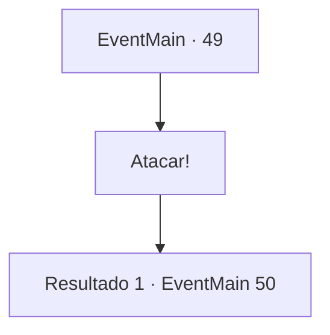

# Eventos principais · 49

[Índice da tabela](index.md) · [Índice geral](../index.md)

ID: `pt:EventMain:49` · Fonte: `EventMain4` · Versão: 1.2.47.

Mapeamento estático dos arquivos; a disponibilidade e a execução dependem do estado da run.

## Texto do evento

*Sem texto no arquivo.*

## Dados de entrada

```json
{
  "id": 49,
  "grade": 1,
  "normalGoal": "",
  "required": ""
}
```

## Mapa das escolhas



## Escolhas e resultados

### Escolha 1

Atacar!

Requisitos e outros campos da escolha:

```json
{
  "required": ""
}
```

#### Resultado 1.1

Você sinaliza suas tropas quando as forças élficas estão nas profundezas do vale.  As flechas chovem, pintando de vermelho as peles brancas dos elfos.  Suas tropas esgotam suas flechas antes de gritar e avançar em direção a tropa inimiga.  Liderando, você cavalga na frente dos soldados.

Continuação registrada: [Evento 50](0050.md) na mesma tabela.

```json
{
  "required": "",
  "chance": "1",
  "nextEvent": 50,
  "type": 2,
  "reward": "6_2_59",
  "place": 1
}
```

## Referências que chegam a este evento

- [Evento 48 · escolha 1 · resultado 1](0048.md#escolha-1)
- [Evento 48 · escolha 2 · resultado 1](0048.md#escolha-2)
