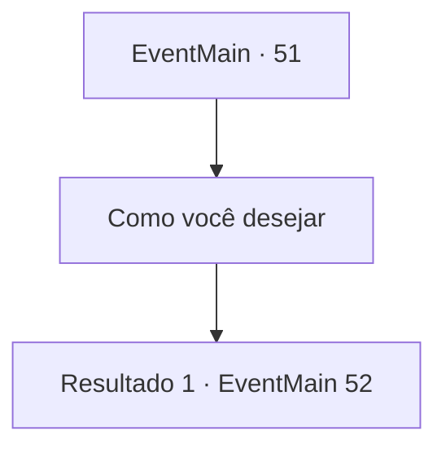

# Eventos principais · 51

[Índice da tabela](index.md) · [Índice geral](../index.md)

ID: `pt:EventMain:51` · Fonte: `EventMain4` · Versão: 1.2.47.

Mapeamento estático dos arquivos; a disponibilidade e a execução dependem do estado da run.

## Texto do evento

Você falhou miseravelmente na missão do Conde Jimradi. Jimradi ouve seu relatório e solta um suspiro. 

 "...Eu te darei uma última chance."

 Ele quer que você ataque as forças élficas que cruzam o 'Vale dos Ventos Negros' imediatamente.

## Dados de entrada

```json
{
  "id": 51,
  "grade": 1,
  "normalGoal": "",
  "required": "13_0_23"
}
```

## Mapa das escolhas



## Escolhas e resultados

### Escolha 1

Como você desejar

Requisitos e outros campos da escolha:

```json
{
  "required": ""
}
```

#### Resultado 1.1

Você lidera suas tropas para o vale com rapidez.  Você chega algumas horas depois  e esconde-se em arbustos e árvores.  Forças élficas aparecem pouco depois.  Eles parecem estar transportando suprimentos.

Continuação registrada: [Evento 52](0052.md) na mesma tabela.

```json
{
  "required": "",
  "chance": "1",
  "nextEvent": 52,
  "type": 2,
  "reward": ""
}
```

## Referências que chegam a este evento

Nenhum `nextEvent` positivo da mesma tabela aponta para este nó. Isso não prova que seja inacessível: sorteio e estado de história podem selecioná-lo.

