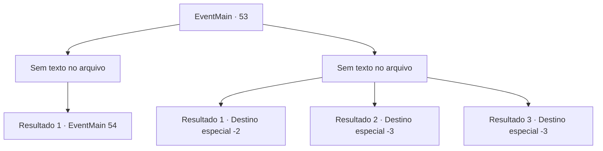

# Eventos principais · 53

[Índice da tabela](index.md) · [Índice geral](../index.md)

ID: `pt:EventMain:53` · Fonte: `EventMain4` · Versão: 1.2.47.

Mapeamento estático dos arquivos; a disponibilidade e a execução dependem do estado da run.

## Texto do evento

*Sem texto no arquivo.*

## Dados de entrada

```json
{
  "id": 53,
  "grade": 1,
  "normalGoal": "",
  "required": ""
}
```

## Mapa das escolhas



## Escolhas e resultados

### Escolha 1

*Sem texto no arquivo; o papel dessa opção depende da interface do jogo.*

Requisitos e outros campos da escolha:

```json
{
  "required": ""
}
```

#### Resultado 1.1

Você derrota um soldado élfico sem suar. Olhando ao redor, você nota um elfo cortando suas tropas como se fossem folhas. Um elfi ferido se aproxima, fumegando. <link=shake>

 "Venha até mim, seu ladrão!"

</link>

Continuação registrada: [Evento 54](0054.md) na mesma tabela.

```json
{
  "required": "",
  "chance": "1",
  "nextEvent": 54,
  "type": 2,
  "reward": "6_2_58",
  "place": 1
}
```

### Escolha 2

*Sem texto no arquivo; o papel dessa opção depende da interface do jogo.*

Requisitos e outros campos da escolha:

```json
{
  "required": ""
}
```

#### Resultado 2.1

Você é cortado por uma espada élfica e levado para longe das linhas de frente.  Suas tropas estão caindo por todos os lados.  Você escolhe recuar com o que resta de suas forças.  Jimradi está furioso. Ele te expulsa.

Continuação registrada: [Destino especial `-2`](../destinos-especiais.md).

```json
{
  "required": "1_0_2|1_1_2",
  "chance": "1",
  "nextEvent": -2,
  "type": 2,
  "reward": "0_0_-1|0_1_-1|13_0_25|0_2_1"
}
```

#### Resultado 2.2

Um elfo balança uma espada contra você, ferindo você criticamente. As tropas vêm em seu socorro, mas não com rapidez suficiente. Sua visão escurece.

Continuação registrada: [Destino especial `-3`](../destinos-especiais.md).

```json
{
  "required": "2_0_2",
  "chance": "1",
  "nextEvent": -3,
  "type": 2,
  "reward": "0_0_-1|0_1_-1"
}
```

#### Resultado 2.3

Um elfo balança uma espada contra você, ferindo você criticamente. As tropas vêm em seu socorro, mas não com rapidez suficiente. Sua visão escurece.

Continuação registrada: [Destino especial `-3`](../destinos-especiais.md).

```json
{
  "required": "2_1_2",
  "chance": "1",
  "nextEvent": -3,
  "type": 2,
  "reward": "0_0_-1|0_1_-1"
}
```

## Referências que chegam a este evento

- [Evento 52 · escolha 1 · resultado 1](0052.md#escolha-1)
