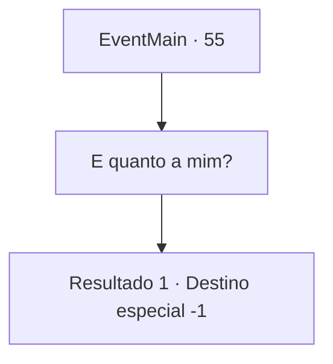

# Eventos principais · 55

[Índice da tabela](index.md) · [Índice geral](../index.md)

ID: `pt:EventMain:55` · Fonte: `EventMain4` · Versão: 1.2.47.

Mapeamento estático dos arquivos; a disponibilidade e a execução dependem do estado da run.

## Texto do evento

Seus esforços diminuíram drasticamente as forças élficas. Eles decidem deixar suas casas para trás, já que não podem mais lutar pela fronteira.
 Mas você não recebe muito crédito. Conde Jimradi, por outro lado, recebe uma promoção e terras extras por seus esforços contra os elfos.

## Dados de entrada

```json
{
  "id": 55,
  "grade": 1,
  "normalGoal": "",
  "required": "13_0_24|1_2_100"
}
```

## Mapa das escolhas



## Escolhas e resultados

### Escolha 1

E quanto a mim?

Requisitos e outros campos da escolha:

```json
{
  "required": ""
}
```

#### Resultado 1.1

Você se torna vice no governo de Jimradi. Todos os créditos vão para Jimradi, mas rumores de sua bravura se espalharam como fogo entre as tropas e o povo”.

Continuação registrada: [Destino especial `-1`](../destinos-especiais.md).

```json
{
  "required": "",
  "chance": "1",
  "nextEvent": -1,
  "type": 2,
  "reward": "15_1_9"
}
```

## Referências que chegam a este evento

Nenhum `nextEvent` positivo da mesma tabela aponta para este nó. Isso não prova que seja inacessível: sorteio e estado de história podem selecioná-lo.

