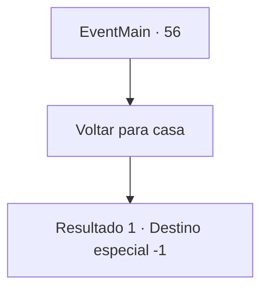

# Eventos principais · 56

[Índice da tabela](index.md) · [Índice geral](../index.md)

ID: `pt:EventMain:56` · Fonte: `EventMain4` · Versão: 1.2.47.

Mapeamento estático dos arquivos; a disponibilidade e a execução dependem do estado da run.

## Texto do evento

Você sente uma dor penetrante perto do peito. Parece ser uma ferida de sua batalha contra os elfos. A dor piora até você achar difícil de respirar. Seu pulmão parece ter sido perfurado.

## Dados de entrada

```json
{
  "id": 56,
  "grade": 1,
  "normalGoal": "",
  "required": "13_0_25|1_2_100"
}
```

## Mapa das escolhas



## Escolhas e resultados

### Escolha 1

Voltar para casa

Requisitos e outros campos da escolha:

```json
{
  "required": ""
}
```

#### Resultado 1.1

Você deixa suas aventuras para trás e volta para casa. Sua família está grata por ver que você está vivo. Seu pai lhe conta as noticias do momento. Os pioneiros e elfos fizeram uma trégua. Você decide se estabelecer e começar a aprender agricultura com seu pai. Sua vida como aventureiro acabou, e sua nova vida como agricultor está apenas começando.|drawing_farm|

Continuação registrada: [Destino especial `-1`](../destinos-especiais.md).

```json
{
  "required": "",
  "chance": "1",
  "nextEvent": -1,
  "type": 2,
  "reward": "15_1_3"
}
```

## Referências que chegam a este evento

Nenhum `nextEvent` positivo da mesma tabela aponta para este nó. Isso não prova que seja inacessível: sorteio e estado de história podem selecioná-lo.

