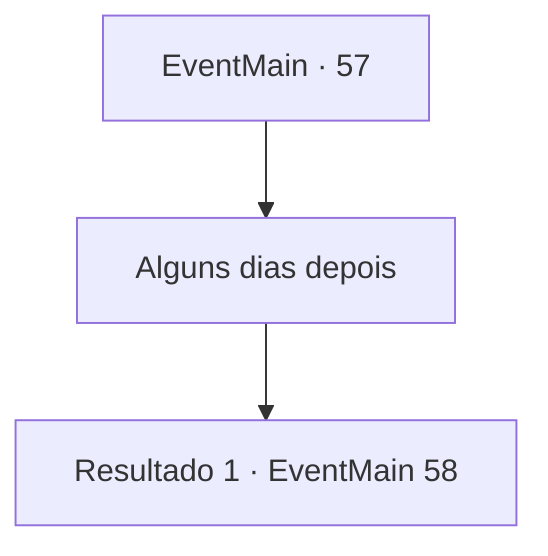

# Eventos principais · 57

[Índice da tabela](index.md) · [Índice geral](../index.md)

ID: `pt:EventMain:57` · Fonte: `EventMain4` · Versão: 1.2.47.

Mapeamento estático dos arquivos; a disponibilidade e a execução dependem do estado da run.

## Texto do evento

*Sem texto no arquivo.*

## Dados de entrada

```json
{
  "id": 57,
  "grade": 1,
  "normalGoal": "",
  "required": ""
}
```

## Mapa das escolhas



## Escolhas e resultados

### Escolha 1

Alguns dias depois

Requisitos e outros campos da escolha:

```json
{
  "required": ""
}
```

#### Resultado 1.1

O sino de alarme enlouquece no acampamento dos pioneiros. |drawing_alram| Legiões de elfos estão reunidas em frente ao acampamento. Seu comandante dá um passo à frente. Ele estende a cabeça de Jimradi e grita. 

 "Seu líder covarde está morto! Abandone o acampamento ou sua vida!"


Continuação registrada: [Evento 58](0058.md) na mesma tabela.

```json
{
  "required": "",
  "chance": "1",
  "nextEvent": 58,
  "type": 2,
  "reward": ""
}
```

## Referências que chegam a este evento

- [Evento 48 · escolha 2 · resultado 2](0048.md#escolha-2)
