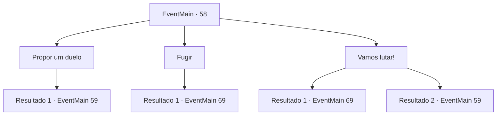

# Eventos principais · 58

[Índice da tabela](index.md) · [Índice geral](../index.md)

ID: `pt:EventMain:58` · Fonte: `EventMain4` · Versão: 1.2.47.

Mapeamento estático dos arquivos; a disponibilidade e a execução dependem do estado da run.

## Texto do evento

*Sem texto no arquivo.*

## Dados de entrada

```json
{
  "id": 58,
  "grade": 1,
  "normalGoal": "",
  "required": ""
}
```

## Mapa das escolhas



## Escolhas e resultados

### Escolha 1

Propor um duelo

Requisitos e outros campos da escolha:

```json
{
  "required": ""
}
```

#### Resultado 1.1

Você olha ao redor do acampamento. Suas tropas perderam a vontade de lutar. Com heroica determinação, você grita, desafiando o general élfico para um duelo. Ele ri e aceita. 

 "Hahaha! Você tem coragem, lhe digo isso! Ótimo! Você vence, nós recuamos."

 E assim começa o duelo.

Continuação registrada: [Evento 59](0059.md) na mesma tabela.

```json
{
  "required": "",
  "chance": "1",
  "nextEvent": 59,
  "type": 2,
  "reward": "6_0_58",
  "place": 1
}
```

### Escolha 2

Fugir

Requisitos e outros campos da escolha:

```json
{
  "required": ""
}
```

#### Resultado 2.1

Você olha ao redor do acampamento. Suas tropas perderam a vontade de lutar. Você sugere às tropas que todos devem se salvar. Eles estavam esperando que alguém dissesse isso. Todas as tropas abandonam imediatamente o acampamento e fogem. 

Continuação registrada: [Evento 69](0069.md) na mesma tabela.

```json
{
  "required": "",
  "chance": "1",
  "nextEvent": 69,
  "type": 2,
  "reward": "0_2_1"
}
```

### Escolha 3

Vamos lutar!

Requisitos e outros campos da escolha:

```json
{
  "required": ""
}
```

#### Resultado 3.1

Você olha ao redor do acampamento. Suas tropas perderam a vontade de lutar. Você grita para suas tropas, em uma tentativa de levantar a moral. Nenhum deles ouve. Todas as tropas abandonam imediatamente o acampamento e fogem. 

Continuação registrada: [Evento 69](0069.md) na mesma tabela.

```json
{
  "required": "",
  "chance": "16",
  "nextEvent": 69,
  "type": 1,
  "reward": "0_2_1"
}
```

#### Resultado 3.2

Você olha ao redor do acampamento. Suas tropas perderam a vontade de lutar. Você se posiciona em um local visivel e persuade as tropas a lutarem contra os elfos, sua voz ressoa até as utimas linhas. Eles se emocionam com o seu discurso e alguns até enxugam as lágrimas. Você lidera suas tropas encorajadas na batalha, o chão treme com os gritos e soldados correndo em direção ao general élfico.

Continuação registrada: [Evento 59](0059.md) na mesma tabela.

```json
{
  "required": "",
  "chance": "1|0_12_1",
  "nextEvent": 59,
  "type": 0,
  "reward": "6_0_58|0_2_2",
  "place": 1
}
```

## Referências que chegam a este evento

- [Evento 57 · escolha 1 · resultado 1](0057.md#escolha-1)
