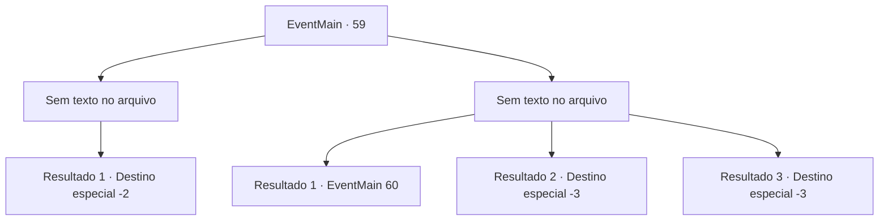

# Eventos principais · 59

[Índice da tabela](index.md) · [Índice geral](../index.md)

ID: `pt:EventMain:59` · Fonte: `EventMain4` · Versão: 1.2.47.

Mapeamento estático dos arquivos; a disponibilidade e a execução dependem do estado da run.

## Texto do evento

*Sem texto no arquivo.*

## Dados de entrada

```json
{
  "id": 59,
  "grade": 1,
  "normalGoal": "",
  "required": ""
}
```

## Mapa das escolhas



## Escolhas e resultados

### Escolha 1

*Sem texto no arquivo; o papel dessa opção depende da interface do jogo.*

Requisitos e outros campos da escolha:

```json
{
  "required": ""
}
```

#### Resultado 1.1

Você mata o general élfico. Ofegante, você olha ao redor do campo de batalha. <link=shake>

 "{1}! {1}! {1}!"

</link> As tropas cantam seu nome enquanto comemoram a vitória. Os elfos perdem o que resta de sua coragem quando a cabeça decepada de seu comandante cai no chão. Eles reconhecem sua derrota e se dispersam.

Continuação registrada: [Destino especial `-2`](../destinos-especiais.md).

```json
{
  "required": "",
  "chance": "1",
  "nextEvent": -2,
  "type": 2,
  "reward": "0_2_5|13_0_26"
}
```

### Escolha 2

*Sem texto no arquivo; o papel dessa opção depende da interface do jogo.*

Requisitos e outros campos da escolha:

```json
{
  "required": ""
}
```

#### Resultado 2.1

Você não é páreo para o general élfico.  A adaga dele perfura sua armadura, depois seu peito.  Você cai sobre seus joelhos e o encara.  Ele fala com você e as tropas atrás de você.  

 "Faça uma escolha. Entregue sua vida,  e esses covardes podem ir embora.  Escolha viver, e todos eles morrem."


Continuação registrada: [Evento 60](0060.md) na mesma tabela.

```json
{
  "required": "1_0_2|1_1_2",
  "chance": "1",
  "nextEvent": 60,
  "type": 2,
  "reward": "0_0_-1|0_1_-1|0_2_1"
}
```

#### Resultado 2.2

Você não é páreo para o general élfico. A adaga dele perfura sua armadura, depois seu peito. Você desmaia no local.

Continuação registrada: [Destino especial `-3`](../destinos-especiais.md).

```json
{
  "required": "2_0_2",
  "chance": "1",
  "nextEvent": -3,
  "type": 2,
  "reward": "0_0_-1|0_1_-1"
}
```

#### Resultado 2.3

Você não é páreo para o general élfico. A adaga dele perfura sua armadura, depois seu peito. Você desmaia no local.

Continuação registrada: [Destino especial `-3`](../destinos-especiais.md).

```json
{
  "required": "2_1_2",
  "chance": "1",
  "nextEvent": -3,
  "type": 2,
  "reward": "0_0_-1|0_1_-1"
}
```

## Referências que chegam a este evento

- [Evento 58 · escolha 1 · resultado 1](0058.md#escolha-1)
- [Evento 58 · escolha 3 · resultado 2](0058.md#escolha-3)
