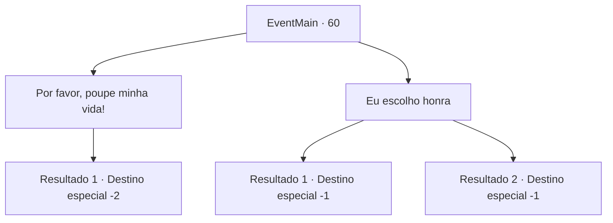

# Eventos principais · 60

[Índice da tabela](index.md) · [Índice geral](../index.md)

ID: `pt:EventMain:60` · Fonte: `EventMain4` · Versão: 1.2.47.

Mapeamento estático dos arquivos; a disponibilidade e a execução dependem do estado da run.

## Texto do evento

*Sem texto no arquivo.*

## Dados de entrada

```json
{
  "id": 60,
  "grade": 1,
  "normalGoal": "",
  "required": ""
}
```

## Mapa das escolhas



## Escolhas e resultados

### Escolha 1

Por favor, poupe minha vida!

Requisitos e outros campos da escolha:

```json
{
  "required": ""
}
```

#### Resultado 1.1

Você implora por sua vida. O general olha para você, decepcionado. 

 "Humanos miseráveis. Saia da minha frente. Seu sangue seria um desrespeito á minha lâmina."

 Suas tropas olham para você com ressentimento, mas você as ignora e foge.

Continuação registrada: [Destino especial `-2`](../destinos-especiais.md).

```json
{
  "required": "",
  "chance": "1",
  "nextEvent": -2,
  "type": 2,
  "reward": "13_0_25|0_3_-5|0_2_2"
}
```

### Escolha 2

Eu escolho honra

Requisitos e outros campos da escolha:

```json
{
  "required": ""
}
```

#### Resultado 2.1

Você pede ao general que poupe suas tropas em troca de sua vida. 

 "Pelo menos você é uma pessoa honrada. Prometo pela dignidade de nossa espécie que os pouparei."

 E com isso, aço frio atravessa seu estômago.

Continuação registrada: [Destino especial `-1`](../destinos-especiais.md).

```json
{
  "required": "24_1_1",
  "chance": "1",
  "nextEvent": -1,
  "type": 2,
  "reward": "15_1_10"
}
```

#### Resultado 2.2

Você pede ao general que poupe suas tropas em troca de sua vida. 

 "Pelo menos você é uma pessoa honrada. Prometo pela dignidade de nossa espécie que os pouparei."

 E com isso, aço frio atravessa seu estômago.

Continuação registrada: [Destino especial `-1`](../destinos-especiais.md).

```json
{
  "required": "23_1_1",
  "chance": "1",
  "nextEvent": -1,
  "type": 2,
  "reward": "25_8_1|15_1_12"
}
```

## Referências que chegam a este evento

- [Evento 59 · escolha 2 · resultado 1](0059.md#escolha-2)
