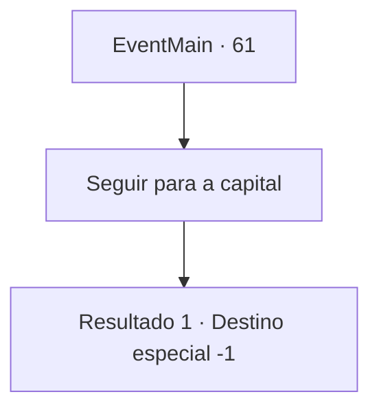

# Eventos principais · 61

[Índice da tabela](index.md) · [Índice geral](../index.md)

ID: `pt:EventMain:61` · Fonte: `EventMain4` · Versão: 1.2.47.

Mapeamento estático dos arquivos; a disponibilidade e a execução dependem do estado da run.

## Texto do evento

Depois da guerra com os elfos, você passa pelo acampamento pioneiro mais uma vez. Ele cresceu tanto que se assemelha a uma cidade. 

 "{1}! É um prazer finalmente conhecê-lo."

 Um homem de terno azul marinho se aproxima de você. Ele se apresenta como mensageiro e lhe entrega uma carta com o selo do rei. |drawing_kingsMessenger|  A carta fala de uma decisão de colocar as fronteiras sob a dependência do Barão, e pergunta se você pode assumir a posição. O mensageiro ajusta seu monóculo e diz. 

 "Vou levá-lo para a capital, Barão {1}."


## Dados de entrada

```json
{
  "id": 61,
  "grade": 1,
  "normalGoal": "",
  "required": "13_0_26|1_2_100"
}
```

## Mapa das escolhas



## Escolhas e resultados

### Escolha 1

Seguir para a capital

Requisitos e outros campos da escolha:

```json
{
  "required": ""
}
```

#### Resultado 1.1

Som de trompetes majestosos enchem a praça enquanto muitos assistem,  e o anfitrião dá-lhe as boas-vindas à plataforma.  

 "Uma salva de palmas para o Herói da Fronteira!"

  As pessoas aplaudem e aplaudem.  Você sobe para a plataforma e se ajoelha lentamente diante do rei.  O rei olha para você e fala.  

 "Todos aqui vão se lembrar de suas aventuras. Eles vão cantar sobre sua bravura nos próximos anos. Eu o nomeio Barão da Fronteira."

  Ele encara as pessoas e grita.  

 "Veja! O herói do nosso Reino!"|drawing_prizeMe| A multidão aplaude estrondosamente.

Continuação registrada: [Destino especial `-1`](../destinos-especiais.md).

```json
{
  "required": "",
  "chance": "1",
  "nextEvent": -1,
  "type": 2,
  "reward": "15_1_0"
}
```

## Referências que chegam a este evento

Nenhum `nextEvent` positivo da mesma tabela aponta para este nó. Isso não prova que seja inacessível: sorteio e estado de história podem selecioná-lo.

