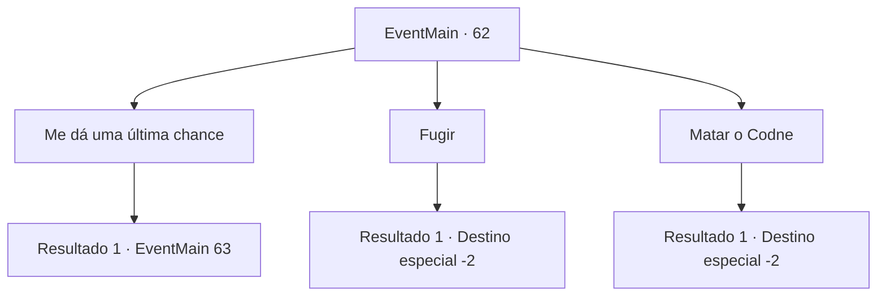

# Eventos principais · 62

[Índice da tabela](index.md) · [Índice geral](../index.md)

ID: `pt:EventMain:62` · Fonte: `EventMain4` · Versão: 1.2.47.

Mapeamento estático dos arquivos; a disponibilidade e a execução dependem do estado da run.

## Texto do evento

Você toma um caminho sinuoso, mas seguro, de volta ao acampamento dos pioneiros. É uma bagunça. Mesmo entre aqueles que sobreviveram à emboscada élfica, apenas alguns retornaram ao acampamento sem fugir. Um Jimradi muito abatido marcha até você. Ele te agarra pelo colarinho e grita. <link=shake>

 "É... é tudo culpa sua...Você sabotou nosso plano!"

</link> Seu rosto está vermelho e ele está quase chorando. 

 "Olhe lá fora. Estamos cercados por aqueles elfos miseráveis! Eles vão chegar até nós a qualquer momento ... estamos todos condenados!"


## Dados de entrada

```json
{
  "id": 62,
  "grade": 1,
  "normalGoal": "",
  "required": "13_0_21|1_2_100"
}
```

## Mapa das escolhas



## Escolhas e resultados

### Escolha 1

Me dá uma última chance

Requisitos e outros campos da escolha:

```json
{
  "required": ""
}
```

#### Resultado 1.1

Você pede ao Conde uma última chance. Ele solta um longo suspiro, expelindo toda a tensão de seus punhos. 

 "Tudo bem, tudo bem. Use qualquer tática brilhante que você ainda não nos mostrou... VÁ!"

 E com isso, ele volta para sua tenda. Você tem apenas algumas tropas e ainda menos tempo.

Continuação registrada: [Evento 63](0063.md) na mesma tabela.

```json
{
  "required": "",
  "chance": "1",
  "nextEvent": 63,
  "type": 2,
  "reward": ""
}
```

### Escolha 2

Fugir

Requisitos e outros campos da escolha:

```json
{
  "required": ""
}
```

#### Resultado 2.1

Você se solta das mãos dele e sai correndo do acampamento. O Conde Jimradi persegue você, mas é muito lento. Você o supera facilmente.

Continuação registrada: [Destino especial `-2`](../destinos-especiais.md).

```json
{
  "required": "",
  "chance": "1",
  "nextEvent": -2,
  "type": 2,
  "reward": "13_0_13|0_2_1"
}
```

### Escolha 3

Matar o Codne

Requisitos e outros campos da escolha:

```json
{
  "required": "2_3_0"
}
```

#### Resultado 3.1

Você sucumbe à sua própria raiva, desembainhar sua espada e mira no seu estômago. Ele já está morto quando você volta aos seus sentidos. Você olha ao redor e vê tropas aterrorizadas. Você foge do acampamento.

Continuação registrada: [Destino especial `-2`](../destinos-especiais.md).

```json
{
  "required": "",
  "chance": "1",
  "nextEvent": -2,
  "type": 2,
  "reward": "0_3_-5|0_2_3|3_116_1|13_0_13"
}
```

## Referências que chegam a este evento

Nenhum `nextEvent` positivo da mesma tabela aponta para este nó. Isso não prova que seja inacessível: sorteio e estado de história podem selecioná-lo.

