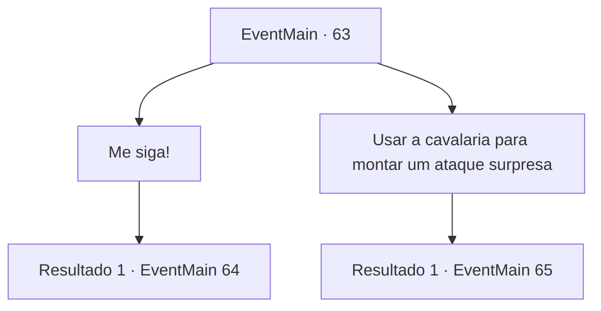

# Eventos principais · 63

[Índice da tabela](index.md) · [Índice geral](../index.md)

ID: `pt:EventMain:63` · Fonte: `EventMain4` · Versão: 1.2.47.

Mapeamento estático dos arquivos; a disponibilidade e a execução dependem do estado da run.

## Texto do evento

*Sem texto no arquivo.*

## Dados de entrada

```json
{
  "id": 63,
  "grade": 1,
  "normalGoal": "",
  "required": ""
}
```

## Mapa das escolhas



## Escolhas e resultados

### Escolha 1

Me siga!

Requisitos e outros campos da escolha:

```json
{
  "required": ""
}
```

#### Resultado 1.1

Você recolhe o que resta de suas tropas.  Então você ataca diretamente os elfos sem pensar duas vezes.  Você os lidera, em frente de todas as tropas.

Continuação registrada: [Evento 64](0064.md) na mesma tabela.

```json
{
  "required": "",
  "chance": "1",
  "nextEvent": 64,
  "type": 2,
  "reward": "6_0_59",
  "place": 1
}
```

### Escolha 2

Usar a cavalaria para montar um ataque surpresa

Requisitos e outros campos da escolha:

```json
{
  "required": "1_7_10"
}
```

#### Resultado 2.1

Você divide suas forças em dois. Você ordena que um grupo use os cavalos e ataque os elfos por trás.  Eles rapidamente partem.  Você e os outros atacam diretamente os elfos.  Você os lidera e os outros seguem atrás.

Continuação registrada: [Evento 65](0065.md) na mesma tabela.

```json
{
  "required": "",
  "chance": "1",
  "nextEvent": 65,
  "type": 2,
  "reward": "6_3_59",
  "place": 1
}
```

## Referências que chegam a este evento

- [Evento 62 · escolha 1 · resultado 1](0062.md#escolha-1)
