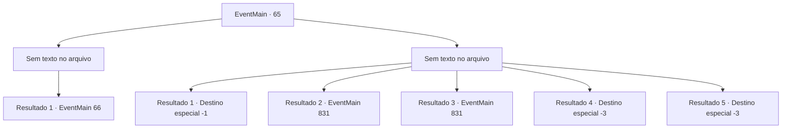

# Eventos principais · 65

[Índice da tabela](index.md) · [Índice geral](../index.md)

ID: `pt:EventMain:65` · Fonte: `EventMain4` · Versão: 1.2.47.

Mapeamento estático dos arquivos; a disponibilidade e a execução dependem do estado da run.

## Texto do evento

*Sem texto no arquivo.*

## Dados de entrada

```json
{
  "id": 65,
  "grade": 1,
  "normalGoal": "",
  "required": ""
}
```

## Mapa das escolhas



## Escolhas e resultados

### Escolha 1

*Sem texto no arquivo; o papel dessa opção depende da interface do jogo.*

Requisitos e outros campos da escolha:

```json
{
  "required": ""
}
```

#### Resultado 1.1

Você derrubou vários elfos.  Você olha em volta para ver a maioria de suas tropas mortas ou fugindo,  lhe deixando sozinho em um mar de inimigos.  Nesse momento, a cavalaria começa a atacar os elfos por trás.  Abalados por sua estrategia eles dispersam suas tropas,  a esperança renasce no seu peito e você levanta sua espada contra o exercito inimigo mais uma vez.

Continuação registrada: [Evento 66](0066.md) na mesma tabela.

```json
{
  "required": "",
  "chance": "1",
  "nextEvent": 66,
  "type": 2,
  "reward": "6_2_72",
  "place": 1
}
```

### Escolha 2

*Sem texto no arquivo; o papel dessa opção depende da interface do jogo.*

Requisitos e outros campos da escolha:

```json
{
  "required": ""
}
```

#### Resultado 2.1

Você é levado em cativeiro junto com alguns outros sobreviventes. Tudo o que você pode fazer é esperar que os outros negociem bem o suficiente e o libertem.

Continuação registrada: [Destino especial `-1`](../destinos-especiais.md).

```json
{
  "required": "1_0_2|1_1_2|24_1_1",
  "chance": "1",
  "nextEvent": -1,
  "type": 2,
  "reward": "15_1_8"
}
```

#### Resultado 2.2

Você é levado em cativeiro junto com alguns outros sobreviventes. Tudo o que você pode fazer é esperar que os outros negociem bem o suficiente e o libertem.

Continuação registrada: [Evento 831](0831.md) na mesma tabela.

```json
{
  "required": "1_0_2|1_1_2|23_1_1",
  "chance": "1",
  "nextEvent": 831,
  "type": 2,
  "reward": ""
}
```

#### Resultado 2.3

Você é levado em cativeiro junto com alguns outros sobreviventes. Tudo o que você pode fazer é esperar que os outros negociem bem o suficiente e o libertem.

Continuação registrada: [Evento 831](0831.md) na mesma tabela.

```json
{
  "required": "1_0_2|1_1_2|23_1_1",
  "chance": "1",
  "nextEvent": 831,
  "type": 2,
  "reward": ""
}
```

#### Resultado 2.4

Você perde sua vida no campo de batalha, junto com inúmeros outros.

Continuação registrada: [Destino especial `-3`](../destinos-especiais.md).

```json
{
  "required": "2_0_2",
  "chance": "1",
  "nextEvent": -3,
  "type": 2,
  "reward": "0_0_-1|0_1_-1"
}
```

#### Resultado 2.5

Você perde sua vida no campo de batalha, junto com inúmeros outros.

Continuação registrada: [Destino especial `-3`](../destinos-especiais.md).

```json
{
  "required": "2_1_2",
  "chance": "1",
  "nextEvent": -3,
  "type": 2,
  "reward": "0_0_-1|0_1_-1"
}
```

## Referências que chegam a este evento

- [Evento 63 · escolha 2 · resultado 1](0063.md#escolha-2)
