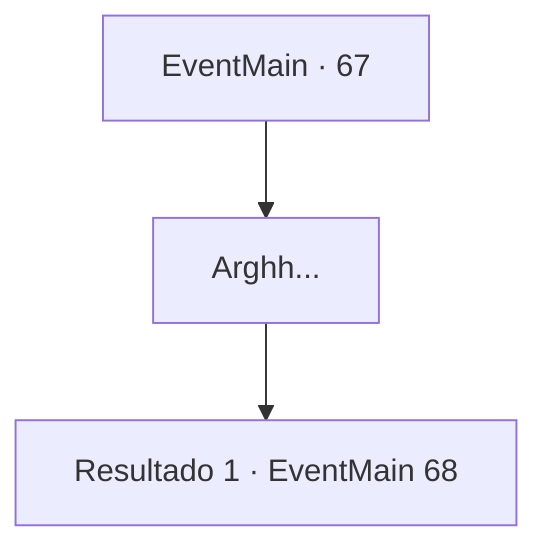

# Eventos principais · 67

[Índice da tabela](index.md) · [Índice geral](../index.md)

ID: `pt:EventMain:67` · Fonte: `EventMain4` · Versão: 1.2.47.

Mapeamento estático dos arquivos; a disponibilidade e a execução dependem do estado da run.

## Texto do evento

*Sem texto no arquivo.*

## Dados de entrada

```json
{
  "id": 67,
  "grade": 1,
  "normalGoal": "",
  "required": ""
}
```

## Mapa das escolhas



## Escolhas e resultados

### Escolha 1

Arghh...

Requisitos e outros campos da escolha:

```json
{
  "required": ""
}
```

#### Resultado 1.1

Você não tem ideia de quanto tempo se passou enquanto você abre os olhos. Você está em uma tenda. 

 "Você está acordado... finalmente!"

 Você se vira para encontrar o Conde Jimradi cuidando de você. Ele olha para você com um sorriso agradável, e atualiza você sobre o que aconteceu depois que você caiu. Os elfos recuaram e o Reino decidiu promovê-lo por suas conquistas. 

 "Só estou aqui por causa de suas contribuições. Você tem minha eterna gratidão."

 Ele diz para você falar com o mensageiro esperando do lado de fora. Você sai da barraca e alguém se aproxima de você. 

 "{1}! É um prazer finalmente conhecê-lo."

 Um homem de terno azul marinho se aproxima de você. Ele se apresenta como mensageiro e lhe entrega uma carta com o selo do rei. |drawing_kingsMessenger| A carta fala de uma decisão de colocar as fronteiras sob a dependência do Barão, e pergunta se você pode assumir a posição. O mensageiro ajusta seu monóculo e fala. 

 "Vou levá-lo para a capital, Barão {1}."


Continuação registrada: [Evento 68](0068.md) na mesma tabela.

```json
{
  "required": "",
  "chance": "1",
  "nextEvent": 68,
  "type": 2,
  "reward": ""
}
```

## Referências que chegam a este evento

- [Evento 66 · escolha 1 · resultado 1](0066.md#escolha-1)
