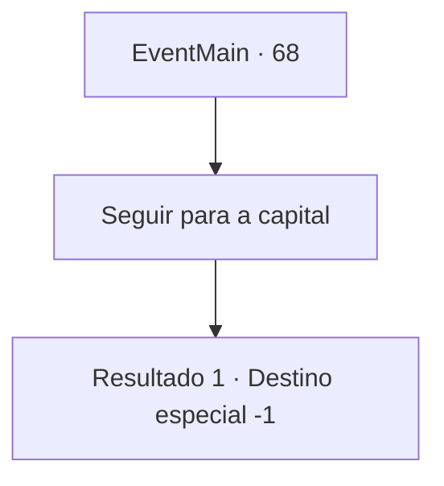

# Eventos principais · 68

[Índice da tabela](index.md) · [Índice geral](../index.md)

ID: `pt:EventMain:68` · Fonte: `EventMain4` · Versão: 1.2.47.

Mapeamento estático dos arquivos; a disponibilidade e a execução dependem do estado da run.

## Texto do evento

*Sem texto no arquivo.*

## Dados de entrada

```json
{
  "id": 68,
  "grade": 1,
  "normalGoal": "",
  "required": ""
}
```

## Mapa das escolhas



## Escolhas e resultados

### Escolha 1

Seguir para a capital

Requisitos e outros campos da escolha:

```json
{
  "required": ""
}
```

#### Resultado 1.1

Som de trompetes majestosos enchem a praça enquanto muitos assistem, e o anfitrião dá-lhe as boas-vindas à plataforma. 

 "Uma salva de palmas para nosso corajoso herói!"

 As pessoas aplaudem e aplaudem. Você sobe para a plataforma e se ajoelha lentamente diante do rei. O rei olha para você e fala. 

 "Todos aqui vão se lembrar de suas aventuras. Eles vão cantar sobre sua bravura nos próximos anos. Eu o nomeio Barão da Fronteira."

 Ele encara as pessoas e grita. 

 "Vejam! O Herói do nosso Reino!"|drawing_prizeMe| A multidão aplaude estrondosamente.

Continuação registrada: [Destino especial `-1`](../destinos-especiais.md).

```json
{
  "required": "",
  "chance": "1",
  "nextEvent": -1,
  "type": 2,
  "reward": "15_1_0"
}
```

## Referências que chegam a este evento

- [Evento 67 · escolha 1 · resultado 1](0067.md#escolha-1)
- [Evento 71 · escolha 1 · resultado 1](0071.md#escolha-1)
