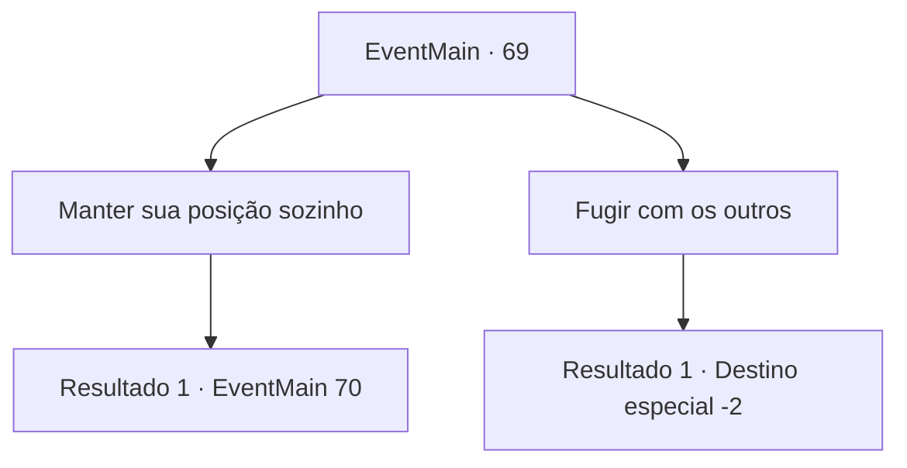

# Eventos principais · 69

[Índice da tabela](index.md) · [Índice geral](../index.md)

ID: `pt:EventMain:69` · Fonte: `EventMain4` · Versão: 1.2.47.

Mapeamento estático dos arquivos; a disponibilidade e a execução dependem do estado da run.

## Texto do evento

*Sem texto no arquivo.*

## Dados de entrada

```json
{
  "id": 69,
  "grade": 1,
  "normalGoal": "",
  "required": ""
}
```

## Mapa das escolhas



## Escolhas e resultados

### Escolha 1

Manter sua posição sozinho

Requisitos e outros campos da escolha:

```json
{
  "required": ""
}
```

#### Resultado 1.1

Você decide ficar no acampamento sozinho enquanto outros fogem. Alguns se curvam levemente, e outros dizem que você é louco. Todos vão embora e você enfrenta as forças élficas sozinho. O comandante élfico gesticula levemente e todos os elfos atacam você de uma vez.

Continuação registrada: [Evento 70](0070.md) na mesma tabela.

```json
{
  "required": "",
  "chance": "1",
  "nextEvent": 70,
  "type": 2,
  "reward": "6_0_72",
  "place": 1
}
```

### Escolha 2

Fugir com os outros

Requisitos e outros campos da escolha:

```json
{
  "required": ""
}
```

#### Resultado 2.1

Você abandona o acampamento e foge com os outros pioneiros.

Continuação registrada: [Destino especial `-2`](../destinos-especiais.md).

```json
{
  "required": "",
  "chance": "1",
  "nextEvent": -2,
  "type": 2,
  "reward": "13_0_7"
}
```

## Referências que chegam a este evento

- [Evento 58 · escolha 2 · resultado 1](0058.md#escolha-2)
- [Evento 58 · escolha 3 · resultado 1](0058.md#escolha-3)
