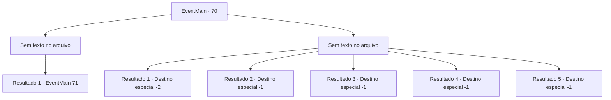

# Eventos principais · 70

[Índice da tabela](index.md) · [Índice geral](../index.md)

ID: `pt:EventMain:70` · Fonte: `EventMain4` · Versão: 1.2.47.

Mapeamento estático dos arquivos; a disponibilidade e a execução dependem do estado da run.

## Texto do evento

*Sem texto no arquivo.*

## Dados de entrada

```json
{
  "id": 70,
  "grade": 1,
  "normalGoal": "",
  "required": ""
}
```

## Mapa das escolhas



## Escolhas e resultados

### Escolha 1

*Sem texto no arquivo; o papel dessa opção depende da interface do jogo.*

Requisitos e outros campos da escolha:

```json
{
  "required": ""
}
```

#### Resultado 1.1

Você está sozinho.
 Cadáveres sangrentos se erguem ao seu redor. Os elfos ficam aterrorizados com o que você é capaz e correm. É somente quando você se solta que você é superado por uma imensa fadiga, e você desmaia no local.

Continuação registrada: [Evento 71](0071.md) na mesma tabela.

```json
{
  "required": "",
  "chance": "1",
  "nextEvent": 71,
  "type": 2,
  "reward": "0_2_5"
}
```

### Escolha 2

*Sem texto no arquivo; o papel dessa opção depende da interface do jogo.*

Requisitos e outros campos da escolha:

```json
{
  "required": ""
}
```

#### Resultado 2.1

Você tenta o seu melhor, mas há apenas tantos soldados élficos que você pode lidar sozinho. Você mal consegue escapar, sua perna, encharcada de sangue pelo que parece ser um corte, dificultou a fuga. Felizmente, os elfos não perseguem você. 

Continuação registrada: [Destino especial `-2`](../destinos-especiais.md).

```json
{
  "required": "1_0_2|1_1_2",
  "chance": "1",
  "nextEvent": -2,
  "type": 2,
  "reward": "0_2_2|0_0_-1|0_1_-1|13_0_10"
}
```

#### Resultado 2.2

Você tenta o seu melhor, mas há apenas tantos soldados élficos que você pode lidar sozinho. Lâminas frias perfuram seu corpo. Você desaparece lentamente, sentindo o calor sendo drenado de seu corpo. 

Continuação registrada: [Destino especial `-1`](../destinos-especiais.md).

```json
{
  "required": "2_0_2|23_1_1",
  "chance": "1",
  "nextEvent": -1,
  "type": 2,
  "reward": "25_8_1|15_1_12"
}
```

#### Resultado 2.3

Você tenta o seu melhor, mas há apenas tantos soldados élficos que você pode lidar sozinho. Lâminas frias perfuram seu corpo. Você desaparece lentamente, sentindo o calor sendo drenado de seu corpo. 

Continuação registrada: [Destino especial `-1`](../destinos-especiais.md).

```json
{
  "required": "2_0_2|24_1_1",
  "chance": "1",
  "nextEvent": -1,
  "type": 2,
  "reward": "15_1_10"
}
```

#### Resultado 2.4

Você tenta o seu melhor, mas há apenas tantos soldados élficos que você pode lidar sozinho. Lâminas frias perfuram seu corpo. Você desaparece lentamente, sentindo o calor sendo drenado de seu corpo. 

Continuação registrada: [Destino especial `-1`](../destinos-especiais.md).

```json
{
  "required": "2_1_2|23_1_1",
  "chance": "1",
  "nextEvent": -1,
  "type": 2,
  "reward": "25_8_1|15_1_12"
}
```

#### Resultado 2.5

Você tenta o seu melhor, mas há apenas tantos soldados élficos que você pode lidar sozinho. Lâminas frias perfuram seu corpo. Você desaparece lentamente, sentindo o calor sendo drenado de seu corpo. 

Continuação registrada: [Destino especial `-1`](../destinos-especiais.md).

```json
{
  "required": "2_1_2|24_1_1",
  "chance": "1",
  "nextEvent": -1,
  "type": 2,
  "reward": "15_1_10"
}
```

## Referências que chegam a este evento

- [Evento 69 · escolha 1 · resultado 1](0069.md#escolha-1)
